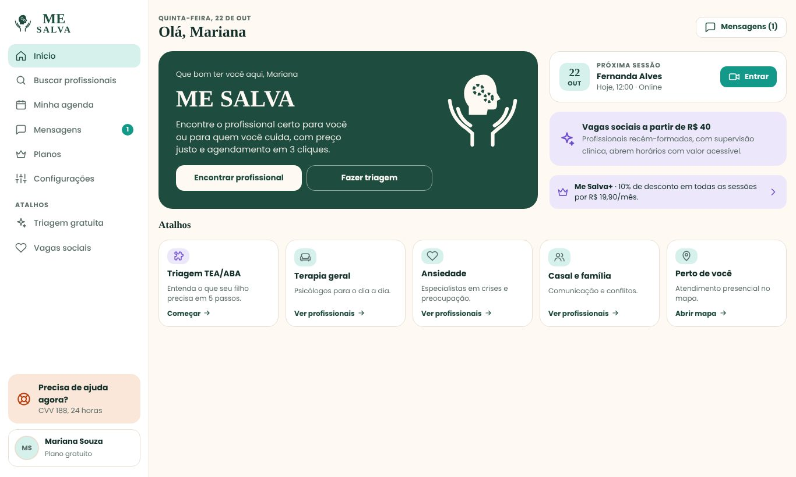
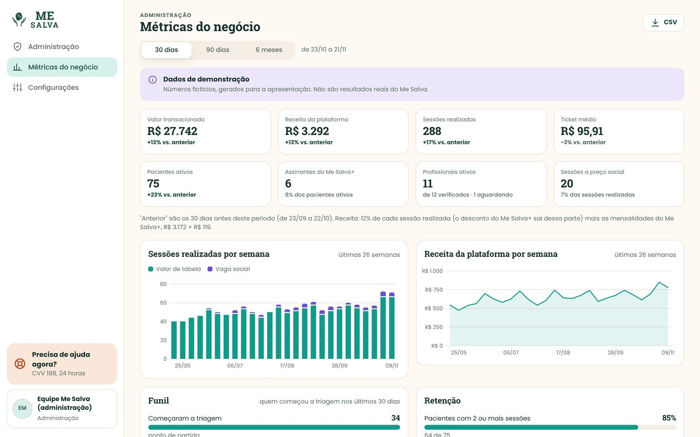
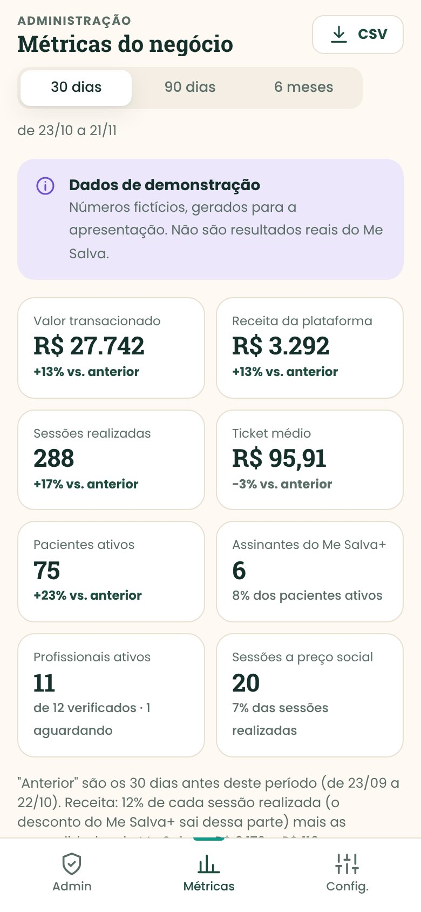
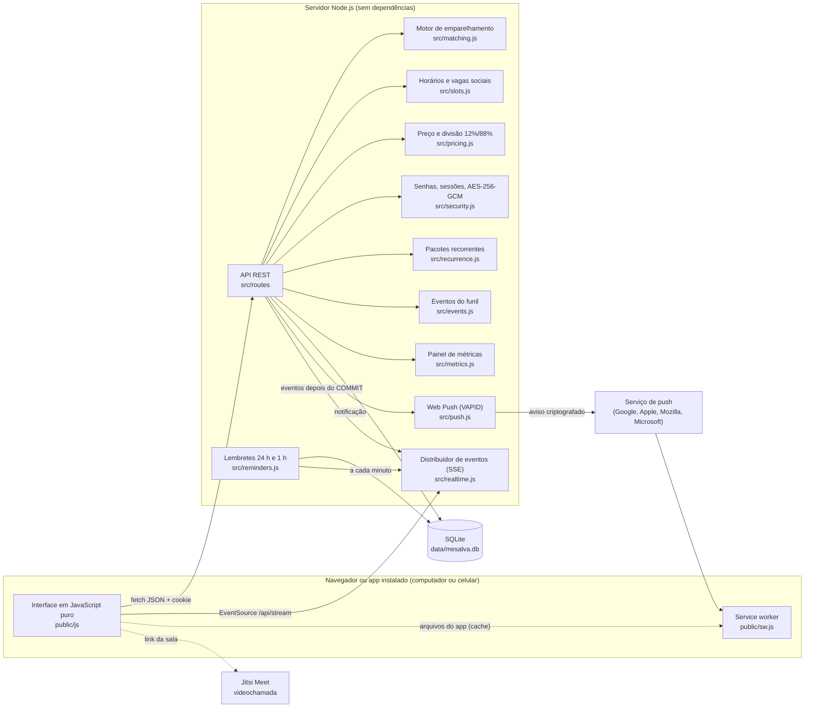

# Me Salva — MVP (versão 1.3)

**A sua terapia na palma da sua mão.** Plataforma web responsiva que conecta pacientes e famílias a profissionais de saúde mental verificados, com triagem guiada (incluindo um caminho para TEA/ABA), emparelhamento por compatibilidade e **vagas sociais** oferecidas por profissionais recém-formados com supervisão clínica.

Projeto da disciplina **Empreendedorismo em Informática** (USP). Os dados de demonstração são fictícios.



## O que o MVP já faz

| Área | Funciona de verdade | Simulado no MVP |
|---|---|---|
| Contas | Cadastro e login de paciente e profissional, sessão segura por cookie, senhas com scrypt | — |
| Verificação | Profissional novo fica "em verificação" e só aparece na busca depois que o administrador aprova | Consulta ao conselho é manual (link para o cadastro do CFP) |
| Triagem | 5 passos sem jargão, com caminho TEA/ABA; respostas salvas; motor de emparelhamento no servidor com restrições, pontuação e motivos | Pesos iniciais definidos pela equipe, ainda sem validação clínica |
| Busca | Filtros por área, tema, modalidade, valor e vaga social; ordenação; lista e mapa por bairro | Mapa esquemático de São Paulo (sem serviço de mapas) |
| Agenda | Horários gerados da disponibilidade semanal, sem conflito (o mesmo horário não pode ser reservado duas vezes), reserva por 15 min até o pagamento, cancelamento com regra de 24 h | — |
| Agendamento recorrente | "Repetir toda semana": dias da semana e duração de 4, 8 ou 12 semanas; conferência de conflitos em todas as datas (com outras pessoas e com as sessões do próprio paciente) e sugestão do horário livre mais próximo; um PIX para o pacote inteiro, com o resumo por sessão; cancelamento de uma sessão ou "esta e as próximas"; agenda do paciente agrupada por pacote e paciente marcado como recorrente na agenda do profissional | — |
| Pagamento | Cálculo do valor, divisão automática (12% plataforma / 88% profissional), desconto do Me Salva+, código PIX no padrão BR Code | Banco e operadora de cartão (cartões de teste) |
| Vagas sociais | Valor social, vagas fixas por semana e preenchimento automático de horários livres nas próximas 24 h | — |
| Chat | Mensagens de texto e de **áudio gravado** entre paciente e profissional, avisos automáticos de confirmação e cancelamento; **em tempo real**: mensagem nova aparece na hora, "Fulana está digitando…" e "visto" (um tique = enviada, dois tiques = vista) | — |
| Notificações | Sino com contador e painel com "Marcar todas como lidas"; avisos de mensagem, sessão confirmada ou cancelada, lembrete, avaliação recebida e registro aprovado ou recusado, chegando em tempo real; aviso do sistema no computador e no celular, inclusive com o app fechado (**Web Push**, sem dependências) | Não há e-mail nem SMS |
| Lembretes | O servidor confere a cada minuto e manda um lembrete 24 h e outro 1 h antes de cada sessão confirmada, como mensagem no chat e como notificação, para paciente e profissional | Botão "Disparar lembretes agora" na administração (só no modo demonstração) |
| Sessão online | Sala com prévia da câmera, cronômetro, encerramento e link para a videochamada (Jitsi Meet) | — |
| Avaliações | Só depois de sessão realizada, uma por sessão, com opção anônima; nota média calculada | — |
| Profissional | Painel com sessões marcadas no mês, ocupação de 6 meses e receita líquida, agenda com presença e falta, edição de perfil e horários, **prontuário criptografado (AES-256-GCM)** com registro de acesso | — |
| LGPD | Consentimento no cadastro, download dos próprios dados (JSON, com os eventos de uso: só tipo e horário) e exclusão da conta | — |
| App no celular | **Instalável** (PWA): ícone na tela inicial, abre em tela cheia respeitando o entalhe e a barra inferior, tela de abertura, atalhos no ícone, botão "Instalar o app" e passo a passo no iPhone; sem internet, página offline com o CVV 188 | A instalação no celular precisa do endereço HTTPS da publicação (Etapa 4) |
| Métricas do negócio | Tela da administração com receita, valor transacionado, sessões, ticket médio, pacientes e profissionais ativos, Me Salva+, funil da triagem à primeira sessão, retenção, vagas sociais e qualidade; gráficos semanais das últimas 26 semanas, filtro de 30 dias, 90 dias ou 6 meses, comparação com o período anterior e exportação em CSV. Os eventos do funil guardam só o tipo, o horário e identificadores internos (sem nome, respostas da triagem, mensagens ou valores) | Os números vêm dos dados de demonstração, que são fictícios |
| Interface | Computador e celular, tema claro (padrão) e escuro, botão de ajuda imediata (CVV 188) em todas as telas, botão Voltar do aparelho; revisão de contraste (texto branco sobre o verde-água de 4,9:1), anel de foco nos campos e botões ajustados para o celular | — |

## Avanços desde o MVP (22/10)

O MVP apresentado em 22/10 era a versão 1.0. Esta tabela compara o que existia naquele dia com o que o app faz agora.

| Área | No MVP de 22/10 (v1.0) | Agora (v1.3) |
|---|---|---|
| Chat | atualizava a cada 3 segundos | em tempo real, com "digitando…" e "visto" |
| Avisos | só mensagens automáticas no chat | central de notificações, lembretes 24 h e 1 h antes e aviso no celular mesmo com o app fechado |
| Celular | site que se adaptava à tela | app instalável na tela inicial, em tela cheia, com página offline e o CVV 188 |
| Famílias ABA | cada sessão agendada e paga separadamente | pacote recorrente: vários dias por semana por 4, 8 ou 12 semanas, conflitos conferidos e um PIX só |
| Gestão do negócio | 4 números do mês na administração | painel de métricas com receita, funil da triagem à primeira sessão, retenção, vagas sociais e qualidade, gráficos semanais e CSV |
| Qualidade das telas | — | revisão de contraste, foco do teclado e botões no celular |
| Testes automáticos | 15 | 58 |

Os números do painel de métricas são dados de demonstração, fictícios, gerados para a apresentação: não são resultados reais do Me Salva.





O que mudou em cada versão está no [CHANGELOG](CHANGELOG.md).

## Como rodar no seu computador

Pré-requisito: **Node.js 22.13 ou mais recente** ([nodejs.org](https://nodejs.org)). O projeto não tem dependências externas: não é preciso rodar `npm install`.

```bash
git clone https://github.com/andreprtl/me-salva
cd me-salva
npm start
```

Abra **http://localhost:3000**. Na primeira execução o banco (`data/mesalva.db`) é criado com os dados de demonstração.

Outros comandos:

```bash
npm run dev    # reinicia sozinho quando um arquivo muda
npm run seed   # apaga o banco e recria os dados de demonstração
npm test       # testes automatizados (regras de negócio, API, tempo real, app instalável, recorrência, Web Push e métricas)
```

### Contas de demonstração

Todas usam a senha **`demo1234`** e aparecem como botões na tela de entrada.

| Conta | E-mail | Para mostrar |
|---|---|---|
| Paciente | `mariana@demo.mesalva.app` | Triagem, busca, agendamento avulso e recorrente, pagamento, chat, sessão de hoje, avaliação e notificações (já começa com 2 não lidas); tem um pacote com o Rafael (seg e qua às 08:00) |
| Profissional recém-formado | `rafael.nunes@demo.mesalva.app` | Painel, vagas sociais, agenda com a Mariana marcada como recorrente e prontuário (começa com o aviso de uma mensagem da Carla) |
| Psicóloga | `fernanda.alves@demo.mesalva.app` | O outro lado do chat e da sessão da Mariana (também começa com 2 notificações não lidas) |
| Profissional em verificação | `beatriz.campos@demo.mesalva.app` | Perfil aguardando aprovação |
| Administração | `admin@demo.mesalva.app` | Aprovar registros, ver as métricas do negócio, restaurar os dados e disparar lembretes |

**Antes de cada apresentação**, entre como administração e use **Restaurar dados de demonstração** (ou rode `npm run seed`). Isso recria as sessões "de hoje" e deixa a sala da Mariana com a Fernanda aberta. A sessão online das duas passa a ficar numa hora cheia entre 1h30 e 2h30 depois da restauração (entre 08:00 e 23:00 do mesmo dia), já com o lembrete de 24 h enviado. Restaurar também recria o histórico de 26 semanas e os eventos do funil que alimentam as métricas, e apaga as notificações antigas: a Mariana e a Fernanda voltam a ter 2 não lidas cada uma (1, se a restauração for depois das 23:00), e o Rafael, o aviso da mensagem da Carla.

**Para mostrar o tempo real**, abra duas janelas com cookies separados (uma janela normal e outra anônima, ou dois perfis do navegador), uma com a Mariana e outra com a Fernanda; se for no mesmo perfil, entrar com a Fernanda desconecta a Mariana. Mande mensagens de um lado e veja o "digitando…", a mensagem e o "visto" aparecerem do outro. Para mostrar o lembrete de 1 h sem esperar, abra uma terceira janela como administração e aperte **Disparar lembretes agora** (ele antecipa o lembrete das sessões que começam nas próximas 3 horas): o aviso chega às duas contas na hora, pelo sino e como mensagem automática no chat. Sem apertar nada, o lembrete chega sozinho quando faltarem 60 minutos para a sessão, o que leva pelo menos 30 minutos depois de restaurar os dados.

**Para mostrar o agendamento recorrente**, entre como Mariana, abra o perfil do Rafael e toque em **Agendar**. Escolha a próxima terça às 15:00, ligue **Repetir toda semana**, marque também a quinta e deixe 4 semanas. Uma das quintas (a da semana seguinte) já está reservada por outra família: a tela mostra o conflito e sugere 14:00 no mesmo dia. Use a sugestão, continue, gere o PIX do pacote e simule o pagamento. A agenda passa a mostrar os dois pacotes agrupados, e na agenda do Rafael a Mariana aparece como "recorrente".

**Para mostrar as métricas**, entre como administração e abra **Métricas do negócio** (no menu, nas abas ou no cartão da visão geral). Troque o filtro entre 30 dias, 90 dias e 6 meses, passe o mouse (ou o dedo, ou use as setas do teclado) sobre os gráficos para ver os números de cada semana e baixe o **CSV**. Em "6 meses" aparece "sem base para comparar", porque o histórico simulado não cobre um período anterior desse tamanho.

**Para mostrar o app no celular**, abra o endereço HTTPS da publicação (Etapa 4) no celular. No Android (Chrome), use o convite da tela inicial ou **Configurações → Instalar o app**; no iPhone (Safari), **Compartilhar → Adicionar à Tela de Início**. O ícone do Me Salva aparece na tela inicial e o app abre em tela cheia. Para receber os lembretes com o app fechado, ligue **Configurações → Avisos do aparelho** (no iPhone, dentro do app instalado).

> A câmera e o microfone só funcionam em `http://localhost` ou em endereços `https://`. O mesmo vale para o service worker: em `http://localhost` ele funciona para testes, mas o celular só instala o app num endereço `https://`.

> Quem já tem o `data/mesalva.db` da versão 1.0, 1.1 ou 1.2 não precisa apagá-lo: as tabelas e as colunas novas são criadas sozinhas. Num banco da v1.2 não existem eventos antigos, então o painel de métricas começa vazio até usar **Restaurar dados de demonstração**. Em `http://localhost` (HTTP/1.1), o navegador abre no máximo 6 conexões por site e cada aba aberta usa uma para o tempo real, então muitas abas no mesmo navegador podem travar; no Render, com HTTPS e HTTP/2, isso não acontece.

## Publicar na internet (Render, gratuito)

1. Suba este repositório no GitHub.
2. Em [render.com](https://render.com), crie um **Web Service** a partir do repositório (o arquivo `render.yaml` já traz a configuração).
3. Build command: *(deixe vazio)* · Start command: `npm start`.
4. O endereço gerado já usa HTTPS, então câmera, microfone, a instalação do app e os avisos com o app fechado funcionam no celular.

No plano gratuito, o disco é apagado quando o serviço reinicia. Para o MVP isso não é problema, porque os dados de demonstração são recriados sozinhos. Também há um `Dockerfile` para rodar em qualquer servidor com Docker:

```bash
docker build -t me-salva .
docker run -p 3000:3000 -v $(pwd)/data:/app/data me-salva
```

## Configuração

Copie `.env.example` para `.env` se quiser mudar algo:

| Variável | Padrão | Para que serve |
|---|---|---|
| `PORT` | `3000` | Porta do servidor |
| `DATA_DIR` | `./data` | Pasta do banco SQLite e da chave do prontuário |
| `DEMO_MODE` | `true` | Abre a sala de vídeo em qualquer horário do dia e libera a restauração dos dados |
| `NOTES_KEY` | gerada em `data/notes.key` | Chave de criptografia do prontuário (64 caracteres hexadecimais ou uma frase longa) |
| `VIDEO_BASE_URL` | `https://meet.jit.si/` | Serviço de videochamada |
| `NODE_ENV` | — | Use `production` para cookies só em HTTPS |
| `PUSH` | ligado | `off` desliga o envio de avisos com o app fechado (Web Push) |
| `VAPID_PUBLIC_KEY` e `VAPID_PRIVATE_KEY` | gerados em `data/vapid.json` | Chaves do Web Push, em base64url. Fixe-as para as inscrições sobreviverem a um disco apagado |
| `VAPID_SUBJECT` | endereço do repositório | Contato enviado aos serviços de push (`https://...` ou `mailto:...`) |

## Arquitetura

> A documentação técnica completa (organização do código, modelo de dados, regras de negócio, API, testes e como fazer mudanças) está em [docs/DOCUMENTACAO.md](docs/DOCUMENTACAO.md). O código também é comentado arquivo por arquivo.



```
me-salva-mvp/
├── CHANGELOG.md            histórico das versões
├── server.js               ponto de entrada (liga a conferência de lembretes)
├── src/
│   ├── app.js              rotas, sessão, cabeçalhos de segurança
│   ├── db.js               esquema do banco
│   ├── matching.js         triagem → necessidades → ranking com motivos
│   ├── slots.js            disponibilidade → horários e vagas sociais
│   ├── pricing.js          valor, desconto e comissão
│   ├── security.js         scrypt, tokens, AES-256-GCM, PIX, Luhn
│   ├── seed.js             dados de demonstração
│   ├── realtime.js         distribuidor de eventos em tempo real (SSE)
│   ├── reminders.js        lembretes 24 h e 1 h antes das sessões
│   ├── recurrence.js       datas, conflitos e sugestões dos pacotes recorrentes
│   ├── events.js           eventos do funil (só tipo, horário e identificadores)
│   ├── metrics.js          cálculos do painel de métricas e exportação em CSV
│   ├── pwa.js              monta o service worker com a versão atual
│   ├── push.js             Web Push: VAPID, criptografia do aviso e envio
│   └── routes/             auth, me, catalog, appointments, packages, messages, pro, admin, metrics, realtime, notifications, push
├── public/
│   ├── index.html · offline.html · manifest.webmanifest
│   ├── sw.js               service worker (app instalável)
│   ├── icons/              ícones e telas de abertura do app
│   ├── css/styles.css
│   └── js/                 core.js, app.js, realtime.js, pwa.js e screens/ (paciente, pacotes, profissional, comuns, notificações, métricas)
├── scripts/icones.mjs      gera os ícones a partir do logo (opcional)
├── test/                   testes de regras, da API, do tempo real, do app instalável, da recorrência, do Web Push e das métricas (node:test)
└── docs/img/               capturas de tela
```

### Como funciona o emparelhamento

1. **Necessidades**: as respostas da triagem viram critérios (público, áreas indicadas com peso, temas, modalidade, orçamento, períodos do dia).
2. **Restrições obrigatórias**: ficam de fora profissionais que não atendem o público, a área, a modalidade, o orçamento (considerando vagas sociais) ou que não têm horário livre em 14 dias. Se sobrarem menos de 3, a busca é ampliada, primeiro no orçamento e depois na modalidade, e o cartão avisa o que não foi atendido.
3. **Pontuação**: soma ponderada de área (30), temas (22), avaliação ajustada pelo número de notas (14), horários no período preferido (12), distância (10), experiência (6) e encaixe no orçamento (6).
4. **Explicação**: cada indicação mostra os três motivos que mais pesaram.

Com 10 mil perfis, o ranking leva menos de 300 ms (há um teste para isso).

## API (resumo)

| Método | Rota | Descrição |
|---|---|---|
| POST | `/api/auth/register` · `/api/auth/login` · `/api/auth/logout` | Conta e sessão |
| GET | `/api/pros` · `/api/pros/:id` · `/api/pros/:id/slots` | Busca, perfil e horários |
| POST | `/api/triage` | Triagem e indicações |
| GET/POST | `/api/appointments` | Agenda e nova reserva |
| POST | `/api/payments/:id/pix-simulate` · `/api/payments/:id/card` | Pagamento simulado |
| POST | `/api/appointments/:id/cancel` · `/finish` · `/no-show` · `/review` | Ciclo da sessão (`cancel` com `{ "following": true }` cancela esta e as próximas do pacote) |
| GET | `/api/pros/:id/recurrence` | Prévia do pacote recorrente: datas, conflitos, sugestões e valores |
| POST | `/api/packages` · `/api/packages/:id/pix-simulate` | Cria o pacote com um PIX do total e simula o pagamento |
| GET | `/api/packages/:id` | Pacote com todas as sessões |
| GET/POST | `/api/push/key` · `/api/push/subscribe` · `/api/push/unsubscribe` | Web Push (avisos com o app fechado) |
| GET | `/api/appointments/:id/room` | Sala de vídeo |
| GET/POST | `/api/conversations/:outroId` | Chat (o GET já traz o campo `seen`, o "visto") |
| POST | `/api/conversations/:outroId/typing` | Avisa que a pessoa está digitando |
| GET | `/api/stream` | Canal em tempo real (Server-Sent Events) para o usuário logado |
| GET | `/api/notifications` | As 50 notificações mais recentes e o número de não lidas |
| POST | `/api/notifications/:id/read` · `/api/notifications/read-all` | Marcar uma ou todas como lidas |
| GET/PUT | `/api/pro/dashboard` · `/api/pro/profile` · `/api/pro/availability` · `/api/pro/social` | Área do profissional |
| GET/POST | `/api/pro/patients/:id/notes` | Prontuário |
| GET/POST | `/api/admin/overview` · `/api/admin/pros/:id/verify` · `/api/admin/reset-demo` | Administração (a visão geral usa as mesmas definições das métricas) |
| GET | `/api/admin/metrics?days=30` | Painel de métricas da administração (`days`: 30, 90 ou 180) |
| GET | `/api/admin/metrics/export?days=30` | Os mesmos números em CSV (`;`, vírgula decimal, valores em reais) |
| POST | `/api/events` | Registra a triagem iniciada (só paciente, só esse tipo de evento) |
| POST | `/api/admin/reminders/run` | Dispara os lembretes agora (só administração e só no modo demonstração) |
| GET/DELETE | `/api/me/export` · `/api/me` | LGPD (a exportação inclui as notificações e os eventos de uso) |
| GET | `/api/unread` | Contadores de mensagens (`count`) e de notificações não lidas (`notifications`) |

Toda chamada que altera dados exige o cabeçalho `x-ms-client: web` (proteção contra CSRF).

## Segurança e privacidade

- Senhas com scrypt e sal aleatório; o token de sessão é guardado só como hash SHA-256.
- Cookie `HttpOnly` e `SameSite=Lax` (e `Secure` em produção); limite de tentativas de login.
- Política de segurança de conteúdo (CSP) sem scripts embutidos; cabeçalhos `X-Frame-Options` e `nosniff`.
- Prontuário criptografado com AES-256-GCM e trilha de auditoria (leitura, escrita, entrada na sala, exportação).
- Os eventos em tempo real só vão para o dono da sessão: o destinatário é sempre decidido pelo servidor a partir do banco, uma conexão só recebe eventos do próprio usuário, e uma mensagem vai apenas para as duas pessoas da conversa. Eventos só saem depois que os dados foram gravados.
- A notificação nunca leva o texto da mensagem (só "Fulana enviou 3 mensagens"), porque o aviso do sistema pode aparecer na tela bloqueada e o assunto é saúde.
- O service worker nunca guarda respostas da API: agenda, mensagens e pagamentos não ficam no aparelho.
- Web Push: o aviso vai criptografado para o aparelho (RFC 8291), o pedido é assinado com VAPID (RFC 8292), e o servidor só envia para os serviços de push conhecidos (Google, Mozilla, Apple e Microsoft), o que impede usar a inscrição para fazer o servidor acessar outros endereços.
- Os eventos do funil guardam só o tipo, o horário e identificadores internos: nada de nome, respostas da triagem, texto de mensagens ou valores. O navegador só consegue registrar "triagem iniciada"; os outros passos nascem no servidor. As métricas só são abertas pela administração. Excluir a conta deixa o evento sem identificação (`user_id` nulo).
- A triagem não faz diagnóstico, e a plataforma não substitui serviços de emergência (CVV 188, SAMU 192).

## Próximos passos (Fase 1 do PIPE)

- Validar as perguntas da triagem e os pesos do motor com especialistas em TEA/ABA.
- Aplicativo React Native e banco PostgreSQL/PostGIS. O app instalável (PWA) e os avisos com o app fechado já foram feitos na v1.2, e as mensagens em tempo real na v1.1; com mais de um servidor, o distribuidor de eventos precisará de um canal compartilhado (Redis ou LISTEN/NOTIFY do PostgreSQL).
- Integração com gateway de pagamento (PIX e cartão com split) e verificação automática do registro profissional.
- Teste de invasão independente e relatório de impacto à proteção de dados (RIPD).
- Piloto com usuários reais após aprovação do Comitê de Ética.

## Equipe

André Portela Lino · João Victor Pereira Lopes · Júlio Arroio Silva · Karina Yang Chen · Marcos Medeiros da Silva Filho

Licença MIT.
