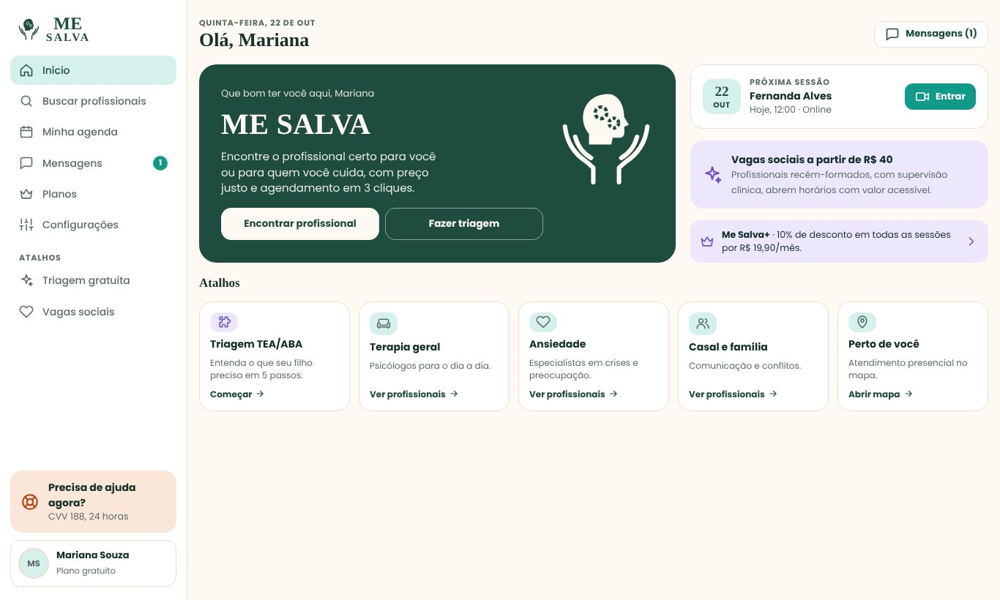
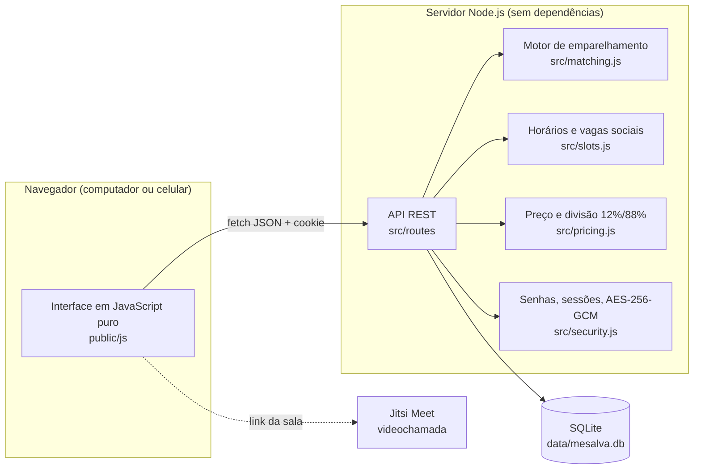

# Me Salva — MVP

**A sua terapia na palma da sua mão.** Plataforma web responsiva que conecta pacientes e famílias a profissionais de saúde mental verificados, com triagem guiada (incluindo um caminho para TEA/ABA), emparelhamento por compatibilidade e **vagas sociais** oferecidas por profissionais recém-formados com supervisão clínica.

Projeto da disciplina **Empreendedorismo em Informática** (USP). Os dados de demonstração são fictícios.



## O que o MVP já faz

| Área | Funciona de verdade | Simulado no MVP |
|---|---|---|
| Contas | Cadastro e login de paciente e profissional, sessão segura por cookie, senhas com scrypt | — |
| Verificação | Profissional novo fica "em verificação" e só aparece na busca depois que o administrador aprova | Consulta ao conselho é manual (link para o cadastro do CFP) |
| Triagem | 5 passos sem jargão, com caminho TEA/ABA; respostas salvas; motor de emparelhamento no servidor com restrições, pontuação e motivos | Pesos iniciais definidos pela equipe, ainda sem validação clínica |
| Busca | Filtros por área, tema, modalidade, valor e vaga social; ordenação; lista e mapa por bairro | Mapa esquemático de São Paulo (sem serviço de mapas) |
| Agenda | Horários gerados da disponibilidade semanal, sem conflito (o mesmo horário não pode ser reservado duas vezes), reserva por 15 min até o pagamento, cancelamento com regra de 24 h | — |
| Pagamento | Cálculo do valor, divisão automática (12% plataforma / 88% profissional), desconto do Me Salva+, código PIX no padrão BR Code | Banco e operadora de cartão (cartões de teste) |
| Vagas sociais | Valor social, vagas fixas por semana e preenchimento automático de horários livres nas próximas 24 h | — |
| Chat | Mensagens de texto e de **áudio gravado** entre paciente e profissional, avisos automáticos de confirmação e cancelamento | Atualização a cada 3 s (sem WebSocket) |
| Sessão online | Sala com prévia da câmera, cronômetro, encerramento e link para a videochamada (Jitsi Meet) | — |
| Avaliações | Só depois de sessão realizada, uma por sessão, com opção anônima; nota média calculada | — |
| Profissional | Painel com ocupação de 6 meses e receita líquida, agenda com presença e falta, edição de perfil e horários, **prontuário criptografado (AES-256-GCM)** com registro de acesso | — |
| LGPD | Consentimento no cadastro, download dos próprios dados (JSON) e exclusão da conta | — |
| Interface | Computador e celular, tema claro (padrão) e escuro, botão de ajuda imediata (CVV 188) em todas as telas | — |

## Como rodar no seu computador

Pré-requisito: **Node.js 22.13 ou mais recente** ([nodejs.org](https://nodejs.org)). O projeto não tem dependências externas: não é preciso rodar `npm install`.

```bash
git clone https://github.com/andreprtl/me-salva
cd me-salva
npm start
```

Abra **http://localhost:3000**. Na primeira execução o banco (`data/mesalva.db`) é criado com os dados de demonstração.

Outros comandos:

```bash
npm run dev    # reinicia sozinho quando um arquivo muda
npm run seed   # apaga o banco e recria os dados de demonstração
npm test       # testes automatizados (regras de negócio e API)
```

### Contas de demonstração

Todas usam a senha **`demo1234`** e aparecem como botões na tela de entrada.

| Conta | E-mail | Para mostrar |
|---|---|---|
| Paciente | `mariana@demo.mesalva.app` | Triagem, busca, agendamento, pagamento, chat, sessão de hoje e avaliação |
| Profissional recém-formado | `rafael.nunes@demo.mesalva.app` | Painel, vagas sociais, agenda e prontuário |
| Psicóloga | `fernanda.alves@demo.mesalva.app` | O outro lado do chat e da sessão da Mariana |
| Profissional em verificação | `beatriz.campos@demo.mesalva.app` | Perfil aguardando aprovação |
| Administração | `admin@demo.mesalva.app` | Aprovar registros, ver indicadores, restaurar os dados |

**Antes de cada apresentação**, entre como administração e use **Restaurar dados de demonstração** (ou rode `npm run seed`). Isso recria as sessões "de hoje" e deixa a sala da Mariana com a Fernanda aberta.

> A câmera e o microfone só funcionam em `http://localhost` ou em endereços `https://`.

## Publicar na internet (Render, gratuito)

1. Suba este repositório no GitHub.
2. Em [render.com](https://render.com), crie um **Web Service** a partir do repositório (o arquivo `render.yaml` já traz a configuração).
3. Build command: *(deixe vazio)* · Start command: `npm start`.
4. O endereço gerado já usa HTTPS, então câmera e microfone funcionam no celular.

No plano gratuito, o disco é apagado quando o serviço reinicia. Para o MVP isso não é problema, porque os dados de demonstração são recriados sozinhos. Também há um `Dockerfile` para rodar em qualquer servidor com Docker:

```bash
docker build -t me-salva .
docker run -p 3000:3000 -v $(pwd)/data:/app/data me-salva
```

## Configuração

Copie `.env.example` para `.env` se quiser mudar algo:

| Variável | Padrão | Para que serve |
|---|---|---|
| `PORT` | `3000` | Porta do servidor |
| `DATA_DIR` | `./data` | Pasta do banco SQLite e da chave do prontuário |
| `DEMO_MODE` | `true` | Abre a sala de vídeo em qualquer horário do dia e libera a restauração dos dados |
| `NOTES_KEY` | gerada em `data/notes.key` | Chave de criptografia do prontuário (64 caracteres hexadecimais ou uma frase longa) |
| `VIDEO_BASE_URL` | `https://meet.jit.si/` | Serviço de videochamada |
| `NODE_ENV` | — | Use `production` para cookies só em HTTPS |

## Arquitetura

> A documentação técnica completa (organização do código, modelo de dados, regras de negócio, API, testes e como fazer mudanças) está em [docs/DOCUMENTACAO.md](docs/DOCUMENTACAO.md). O código também é comentado arquivo por arquivo.



```
me-salva-mvp/
├── server.js               ponto de entrada
├── src/
│   ├── app.js              rotas, sessão, cabeçalhos de segurança
│   ├── db.js               esquema do banco
│   ├── matching.js         triagem → necessidades → ranking com motivos
│   ├── slots.js            disponibilidade → horários e vagas sociais
│   ├── pricing.js          valor, desconto e comissão
│   ├── security.js         scrypt, tokens, AES-256-GCM, PIX, Luhn
│   ├── seed.js             dados de demonstração
│   └── routes/             auth, me, catalog, appointments, messages, pro, admin
├── public/
│   ├── index.html
│   ├── css/styles.css
│   └── js/                 core.js, app.js e screens/ (paciente, profissional, comuns)
├── test/                   testes de regras e da API (node:test)
└── docs/img/               capturas de tela
```

### Como funciona o emparelhamento

1. **Necessidades**: as respostas da triagem viram critérios (público, áreas indicadas com peso, temas, modalidade, orçamento, períodos do dia).
2. **Restrições obrigatórias**: ficam de fora profissionais que não atendem o público, a área, a modalidade, o orçamento (considerando vagas sociais) ou que não têm horário livre em 14 dias. Se sobrarem menos de 3, a busca é ampliada, primeiro no orçamento e depois na modalidade, e o cartão avisa o que não foi atendido.
3. **Pontuação**: soma ponderada de área (30), temas (22), avaliação ajustada pelo número de notas (14), horários no período preferido (12), distância (10), experiência (6) e encaixe no orçamento (6).
4. **Explicação**: cada indicação mostra os três motivos que mais pesaram.

Com 10 mil perfis, o ranking leva menos de 300 ms (há um teste para isso).

## API (resumo)

| Método | Rota | Descrição |
|---|---|---|
| POST | `/api/auth/register` · `/api/auth/login` · `/api/auth/logout` | Conta e sessão |
| GET | `/api/pros` · `/api/pros/:id` · `/api/pros/:id/slots` | Busca, perfil e horários |
| POST | `/api/triage` | Triagem e indicações |
| GET/POST | `/api/appointments` | Agenda e nova reserva |
| POST | `/api/payments/:id/pix-simulate` · `/api/payments/:id/card` | Pagamento simulado |
| POST | `/api/appointments/:id/cancel` · `/finish` · `/no-show` · `/review` | Ciclo da sessão |
| GET | `/api/appointments/:id/room` | Sala de vídeo |
| GET/POST | `/api/conversations/:outroId` | Chat |
| GET/PUT | `/api/pro/dashboard` · `/api/pro/profile` · `/api/pro/availability` · `/api/pro/social` | Área do profissional |
| GET/POST | `/api/pro/patients/:id/notes` | Prontuário |
| GET/POST | `/api/admin/overview` · `/api/admin/pros/:id/verify` · `/api/admin/reset-demo` | Administração |
| GET/DELETE | `/api/me/export` · `/api/me` | LGPD |

Toda chamada que altera dados exige o cabeçalho `x-ms-client: web` (proteção contra CSRF).

## Segurança e privacidade

- Senhas com scrypt e sal aleatório; o token de sessão é guardado só como hash SHA-256.
- Cookie `HttpOnly` e `SameSite=Lax` (e `Secure` em produção); limite de tentativas de login.
- Política de segurança de conteúdo (CSP) sem scripts embutidos; cabeçalhos `X-Frame-Options` e `nosniff`.
- Prontuário criptografado com AES-256-GCM e trilha de auditoria (leitura, escrita, entrada na sala, exportação).
- A triagem não faz diagnóstico, e a plataforma não substitui serviços de emergência (CVV 188, SAMU 192).

## Próximos passos (Fase 1 do PIPE)

- Validar as perguntas da triagem e os pesos do motor com especialistas em TEA/ABA.
- Aplicativo React Native, banco PostgreSQL/PostGIS e mensagens em tempo real.
- Integração com gateway de pagamento (PIX e cartão com split) e verificação automática do registro profissional.
- Teste de invasão independente e relatório de impacto à proteção de dados (RIPD).
- Piloto com usuários reais após aprovação do Comitê de Ética.

## Equipe

André Portela Lino · João Victor Pereira Lopes · Júlio Arroio Silva · Karina Yang Chen · Marcos Medeiros da Silva Filho

Licença MIT.
