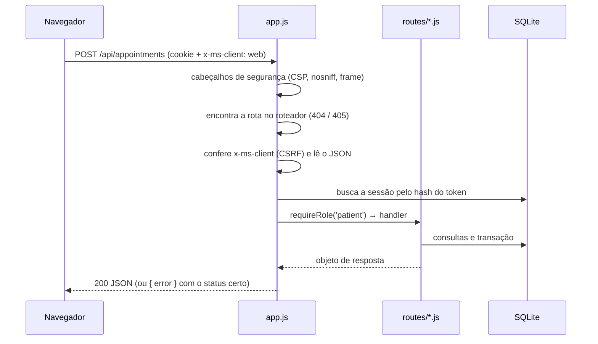
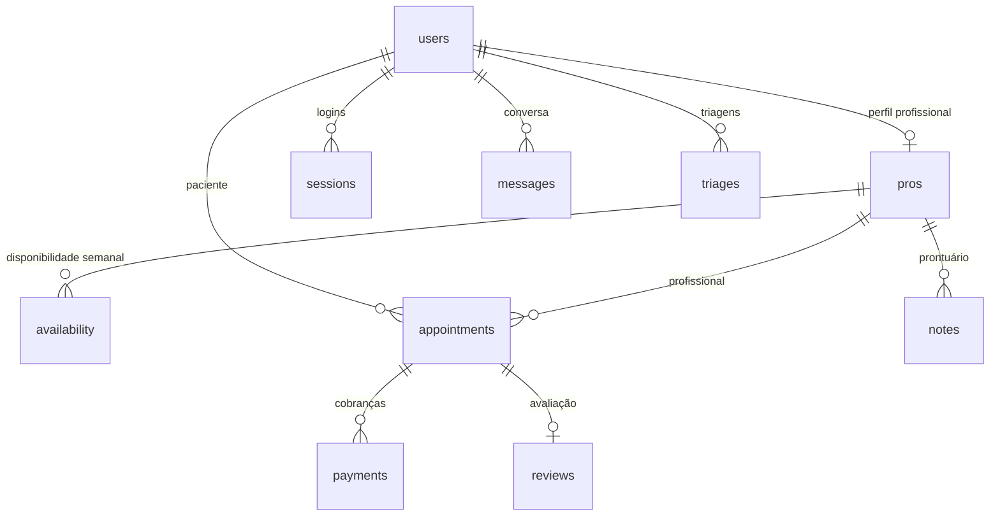
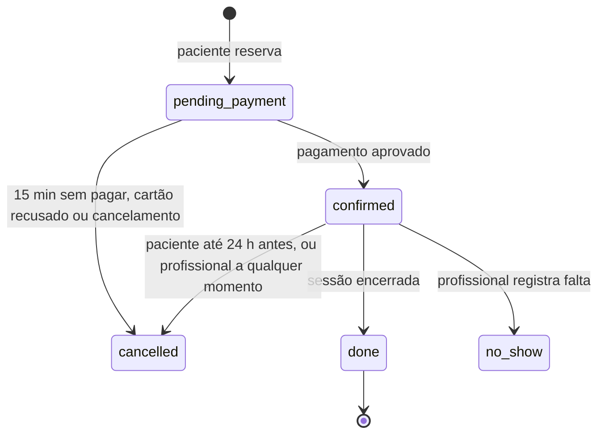

# Documentação técnica do MVP Me Salva

Este documento explica como o código do MVP está organizado, como as partes conversam entre si e onde mexer para fazer as mudanças mais comuns. Para rodar o projeto, publicar e usar as contas de demonstração, veja o [README](../README.md).

Todos os dados de demonstração são fictícios, e o pagamento é simulado.

## Sumário

1. [Visão geral](#1-visão-geral)
2. [Tecnologias e decisões](#2-tecnologias-e-decisões)
3. [Estrutura de pastas](#3-estrutura-de-pastas)
4. [Servidor](#4-servidor)
5. [Interface](#5-interface)
6. [Modelo de dados](#6-modelo-de-dados)
7. [Regras de negócio](#7-regras-de-negócio)
8. [API completa](#8-api-completa)
9. [Segurança e LGPD](#9-segurança-e-lgpd)
10. [Dados de demonstração](#10-dados-de-demonstração)
11. [Testes](#11-testes)
12. [Como fazer mudanças comuns](#12-como-fazer-mudanças-comuns)
13. [Limitações conhecidas](#13-limitações-conhecidas)
14. [Glossário](#14-glossário)

## 1. Visão geral

O Me Salva conecta pacientes e famílias a profissionais de saúde mental verificados. O MVP cobre a jornada inteira de três perfis:

| Perfil | O que faz no MVP |
|---|---|
| Paciente (`patient`) | Faz a triagem, busca profissionais, agenda, paga (PIX ou cartão simulados), conversa no chat, entra na sala de vídeo, avalia a sessão e assina o Me Salva+ |
| Profissional (`pro`) | Acompanha o painel, gerencia agenda e horários, configura vagas sociais, conversa com pacientes e escreve no prontuário criptografado |
| Administração (`admin`) | Vê indicadores, aprova ou recusa registros profissionais e restaura os dados de demonstração |

É uma aplicação web única: o mesmo servidor entrega a API (`/api/...`) e os arquivos da interface (`public/`). A interface funciona no computador e no celular.

## 2. Tecnologias e decisões

| Escolha | Por quê |
|---|---|
| **Node.js 22.13+ sem dependências** | O projeto roda com `npm start` logo após o clone, sem `npm install`. Usa só módulos nativos: `node:http`, `node:sqlite` e `node:crypto`. |
| **SQLite embutido** (`node:sqlite`) | Banco relacional de verdade, num único arquivo (`data/mesalva.db`), sem servidor separado. |
| **JavaScript puro no navegador** (módulos ES) | Sem etapa de build. Cada tela é uma função que devolve HTML. |
| **Horários como texto local de São Paulo** | Sessões são gravadas como `'AAAA-MM-DDTHH:MM'` no fuso de São Paulo, então um servidor em UTC mostra os mesmos horários que o usuário vê (`src/time.js`). |
| **Dinheiro em centavos** | Todos os valores são inteiros em centavos, para evitar erros de arredondamento. |
| **Regras de negócio em funções puras** | Horários (`slots.js`), preço (`pricing.js`) e emparelhamento (`matching.js`) não acessam o banco, o que facilita testar. |

A troca de SQLite por PostgreSQL e da interface por um aplicativo React Native está prevista na Fase 1 do PIPE.

## 3. Estrutura de pastas

```
me-salva-mvp/
├── server.js                 ponto de entrada: abre o banco, cria dados demo se vazio, sobe o HTTP
├── package.json              scripts start, dev, seed e test (sem dependências)
├── .env.example              variáveis de ambiente opcionais
├── Dockerfile · render.yaml  publicação em Docker ou no Render
├── src/                      servidor
│   ├── config.js             leitura das variáveis de ambiente
│   ├── app.js                monta a aplicação: segurança, CSRF, sessão, rotas, arquivos estáticos
│   ├── http.js               mini-framework: roteador, leitura de JSON, cookies, arquivos estáticos
│   ├── guards.js             requireUser e requireRole (controle de acesso)
│   ├── db.js                 esquema do banco e interface all/get/run/tx
│   ├── services.js           consultas reaproveitadas (profissionais, horários, chat, auditoria)
│   ├── time.js               datas no fuso de São Paulo
│   ├── validate.js           validação de entradas com mensagens em português
│   ├── security.js           scrypt, tokens, AES-256-GCM, limite de tentativas, PIX, Luhn
│   ├── pricing.js            valor da sessão e divisão plataforma/profissional
│   ├── slots.js              disponibilidade semanal → horários e vagas sociais
│   ├── matching.js           triagem → necessidades → ranking com motivos
│   ├── seed.js               dados de demonstração (também roda com `npm run seed`)
│   └── routes/
│       ├── auth.js           cadastro, entrada, saída, contas demo
│       ├── me.js             conta, Me Salva+, exportação e exclusão (LGPD)
│       ├── catalog.js        dados de referência, busca, perfil, horários, triagem
│       ├── appointments.js   reserva, pagamento, cancelamento, sala, encerramento, avaliação
│       ├── messages.js       conversas, mensagens de texto e áudio
│       ├── pro.js            painel, perfil, disponibilidade, vagas sociais, prontuário
│       └── admin.js          indicadores, verificação de registros, restauração dos dados
├── public/                   interface (servida como arquivos estáticos)
│   ├── index.html            casca da página: barra lateral, tela, abas, camadas
│   ├── css/styles.css        estilos (tema claro e escuro, computador e celular)
│   └── js/
│       ├── theme.js          aplica o tema salvo antes de desenhar
│       ├── app.js            inicialização e delegação de eventos
│       ├── core.js           estado, chamadas à API, navegação, menus, ícones, formatação
│       ├── shared/data.js    áreas, bairros, temas, preços e textos da triagem (usado também pelo servidor)
│       └── screens/
│           ├── common.js     entrada, login, cadastro, configurações, chat, sala de vídeo
│           ├── patient.js    início, busca, perfil, agendamento, pagamento, agenda, triagem, avaliação, planos
│           └── pro.js        painel, agenda, horários, perfil, prontuário e administração
├── test/
│   ├── domain.test.js        regras puras (horários, preço, emparelhamento, segurança)
│   └── api.test.js           fluxo completo pela API com banco temporário
├── docs/
│   ├── DOCUMENTACAO.md       este documento
│   └── img/                  capturas de tela
└── data/                     criada na primeira execução: mesalva.db e notes.key (fora do Git)
```

## 4. Servidor

### 4.1 Caminho de uma requisição



Pontos importantes:

- **Rotas** são registradas por arquivos em `src/routes/`. Cada arquivo exporta uma função `(router, ctx)`, chamada uma vez em `createApp`. O `ctx` traz `db`, `config`, `svc` (serviços) e `notesKey`.
- **Handlers em sequência**: `r.get('/api/pro/dashboard', requireRole('pro'), handler)`. A guarda lança erro se o acesso não for permitido; o handler devolve um objeto, que vira JSON.
- **Erros**: as rotas lançam `HttpError(status, mensagem)` ou usam `bad(mensagem)` (400). A mensagem chega pronta para aparecer na tela. Erros inesperados vão para o log e o usuário recebe uma mensagem genérica.
- **Arquivos estáticos**: qualquer caminho fora de `/api/` é procurado em `public/`. Se não existir, o servidor devolve `index.html`, e a interface decide a tela.

### 4.2 Serviços compartilhados (`services.js`)

| Função | Para que serve |
|---|---|
| `getPro(id)` / `listPros(where)` | Profissional com nota média e número de avaliações |
| `template(id)` | Disponibilidade semanal do profissional |
| `slotsFor(pro)` | Horários dos próximos 14 dias, já sem reservas vencidas |
| `expirePending()` | Cancela reservas não pagas há mais de 15 minutos |
| `pushMessage(...)` | Grava mensagem no chat (inclusive avisos automáticos) |
| `unreadCount(user)` | Número de mensagens não lidas |
| `roomOpen(appt)` | Se a sala de vídeo já pode ser aberta |
| `audit(user, ação, alvo)` | Registro na trilha de auditoria |

## 5. Interface

A interface é uma aplicação de página única, em JavaScript puro.

- **Registro de telas** (`core.js`): cada tela é registrada com `screen(nome, { load, view, after, nav, tabs, width, bare })`. `load` busca os dados, `view` devolve o HTML e `after` roda depois de desenhar.
- **Navegação em pilha**: `go(tela, parâmetro)` abre uma tela por cima, `back()` volta, `tab(tela)` recomeça a pilha (itens do menu) e `replace` troca a tela atual.
- **Eventos por delegação** (`app.js`): o HTML não tem `onclick`. Botões usam `data-a="nomeDaAcao"` (funções em `A`), formulários usam `data-f` (funções em `F`) e campos usam `data-i` (funções em `I`). Isso permite a CSP sem scripts inline.
- **Camadas**: folhas sobrepostas (confirmação, filtros, ajuda imediata, carregando) usam `openLayer(tipo, dados)` e as funções em `LAYERS`.
- **Atualização**: o chat aberto busca mensagens novas a cada 3 segundos; o contador de não lidas é atualizado a cada 15 segundos.
- **Layout**: a partir de 960 px de largura, a interface usa barra lateral; abaixo disso, abas inferiores de aplicativo.
- **Tema**: claro por padrão; o escuro é ligado em Configurações e lembrado no navegador.
- **Segurança**: todo texto vindo da API passa por `esc()` antes de entrar no HTML.

Telas por arquivo:

| Arquivo | Telas |
|---|---|
| `screens/common.js` | `entrada`, `login`, `cadastro`, `config`, `chats`, `chat`, `sessao` |
| `screens/patient.js` | `home`, `areas`, `busca`, `perfil`, `agendar`, `pagamento`, `pix`, `confirmado`, `agenda`, `avaliar`, `triagem`, `trires`, `planos` |
| `screens/pro.js` | `painel`, `proagenda`, `horarios`, `properfil`, `prontuario`, `admin` |

## 6. Modelo de dados



| Tabela | Campos principais | Observações |
|---|---|---|
| `users` | `role`, `name`, `email`, `pass_hash`, `bairro`, `plan` | `role` é `patient`, `pro` ou `admin`; `plan` é `free` ou `plus` |
| `sessions` | `token_hash`, `user_id`, `expires_at` | Guarda só o hash SHA-256 do token; vale 7 dias |
| `pros` | `area`, `reg`, `topics`, `audience`, `modalities`, `price`, `is_new`, `supervisor`, `social_price`, `social_weekly`, `auto_fill`, `status` | `status` é `pending`, `verified` ou `rejected`; listas em JSON |
| `availability` | `pro_id`, `weekday`, `hour` | Um registro por horário semanal (0 = domingo) |
| `appointments` | `start`, `modality`, `social`, `base_price`, `amount`, `fee`, `pro_amount`, `status`, `room`, `expires_at` | Índice único `appt_slot` impede duas reservas ativas no mesmo horário |
| `payments` | `kind`, `method`, `amount`, `fee`, `pro_amount`, `status`, `pix_code`, `card_last4` | `kind` é `session` ou `plus`; `status`: `pending`, `paid`, `refunded`, `expired`, `failed` |
| `messages` | `patient_id`, `pro_id`, `sender_id`, `kind`, `body`, `audio`, `read_by_*` | `kind` é `text`, `audio` ou `system`; áudio guardado como data URL |
| `reviews` | `appointment_id` (único), `rating`, `tags`, `text`, `author_label` | Uma por sessão realizada |
| `triages` | `answers`, `needs` | Respostas e critérios derivados, em JSON |
| `notes` | `pro_id`, `patient_id`, `iv`, `tag`, `data` | Texto do prontuário criptografado com AES-256-GCM |
| `audit` | `user_id`, `action`, `target` | Ex.: `login`, `notes.read`, `pro.verified`, `data.export` |

O esquema fica em `src/db.js`. Como ele usa `CREATE TABLE IF NOT EXISTS`, uma coluna nova não é criada num banco que já existe: no MVP, apague `data/mesalva.db` e reinicie.

## 7. Regras de negócio

### 7.1 Ciclo de uma sessão



- Ao confirmar, o sistema cria o nome da sala de vídeo e manda um aviso automático no chat.
- Cancelamento de sessão paga devolve o valor (`payments.status = refunded`) e avisa no chat.
- A sala de vídeo abre 15 minutos antes e fecha 60 minutos depois do início. No modo demonstração (`DEMO_MODE=true`), fica aberta no dia todo.

### 7.2 Horários e vagas sociais (`slots.js`)

- Os horários dos próximos 14 dias são gerados a partir da disponibilidade semanal do profissional.
- Horários que começam em menos de 1 hora não são oferecidos.
- **Vagas sociais** só existem para profissionais recém-formados (`is_new`) com supervisor cadastrado e valor social definido (R$ 40 a R$ 80, abaixo do valor normal).
- As primeiras N vagas de cada semana (de segunda a domingo) são sociais, onde N é `social_weekly` (0 a 12).
- Com o **preenchimento automático** ligado, qualquer horário livre nas próximas 24 horas também vira vaga social.

### 7.3 Preço e divisão (`pricing.js`)

O profissional sempre recebe 88% do valor de tabela (ou do valor social). O desconto do Me Salva+ (10%) sai da parte da plataforma.

| Caso (sessão de R$ 100) | Paciente paga | Profissional recebe | Plataforma fica com |
|---|---|---|---|
| Plano gratuito | R$ 100,00 | R$ 88,00 | R$ 12,00 |
| Me Salva+ | R$ 90,00 | R$ 88,00 | R$ 2,00 |
| Vaga social de R$ 45, plano gratuito | R$ 45,00 | R$ 39,60 | R$ 5,40 |

Os percentuais e preços ficam em `PRICING`, no arquivo `public/js/shared/data.js`.

### 7.4 Triagem e emparelhamento (`matching.js`)

**1. Necessidades.** `deriveNeeds(respostas)` transforma as respostas leigas em critérios:

| Situação | Áreas indicadas (peso de 0 a 1) | Outros critérios |
|---|---|---|
| Criança com TEA confirmado | ABA 1 · Terapia ocupacional 0,5 · Psicologia 0,4 | Tema TEA; sinais viram temas (comunicação, rotina, integração sensorial…); apoio "muito" → alta frequência |
| Criança em investigação ou sem diagnóstico | Neuropsicologia 1 · Psiquiatria 0,9 · ABA 0,6 · Psicologia 0,3 | Mesmo tratamento dos sinais |
| Adulto | Psicologia 1 · Psicanálise 0,5 (0,9 se "autoconhecimento") · Psiquiatria 0,7 se TDAH | Motivos viram temas; sintomas intensos → urgência e psiquiatria 0,9 |

Também entram público (crianças, adolescentes ou adultos), modalidade, orçamento máximo e períodos do dia.

**2. Restrições obrigatórias.** Fica de fora quem não é de uma área indicada, não atende o público, não tem horário livre em 14 dias, não atende na modalidade escolhida ou custa mais que o orçamento (considerando a vaga social livre). Se sobrarem menos de 3 opções, a busca é ampliada: primeiro o orçamento e depois a modalidade. O cartão avisa o que não foi atendido.

**3. Pontuação.** Cada critério vira um número de 0 a 1, e a nota final (0 a 100) é a média ponderada:

| Critério | Peso | Como é medido |
|---|---|---|
| Área | 30 | Peso da área na tabela acima |
| Temas | 22 | Temas da triagem presentes no perfil (até 3) |
| Avaliação | 14 | Nota bayesiana: com poucas avaliações, a nota é puxada para 4,0 |
| Disponibilidade | 12 | Horários livres no período preferido (3 ou mais = máximo) |
| Distância | 10 | Até 20 km, quando o atendimento presencial importa |
| Experiência | 6 | Anos de atuação (10 ou mais = máximo) |
| Orçamento | 6 | Cabe ou não no valor informado |

**4. Ordem e explicação.** Quem atende a todas as restrições vem primeiro; depois vale a nota. Cada indicação mostra os três motivos que mais pesaram, como "Vaga social de R$ 45 cabe no seu orçamento". A rota `/api/triage` devolve as 5 primeiras indicações.

Os pesos são uma versão inicial definida pela equipe e serão revistos com especialistas (atividade A2 do PIPE). Há um teste que garante menos de 300 ms com 10 mil perfis.

### 7.5 Outras regras

| Tema | Regra |
|---|---|
| Cadastro de profissional | Registro precisa começar com o conselho da área (CRP, CRM ou CREFITO); recém-formado precisa informar supervisor; valor entre R$ 40 e R$ 1.000 |
| Verificação | Profissional novo fica `pending` e não aparece na busca até a administração aprovar |
| Reserva | Horário fica guardado por 15 minutos até o pagamento; o servidor recalcula horário e preço |
| Cartão de teste | 4242 4242 4242 4242 é aprovado; 4000 0000 0000 0002 é recusado e libera o horário |
| Avaliação | Só depois de sessão realizada, uma por sessão, nota de 1 a 5, destaques, comentário de até 600 caracteres e opção anônima |
| Chat | Profissional só conversa com quem tem ou teve sessão com ele; áudio de até cerca de 1 minuto |
| Prontuário | Só para pacientes da agenda do profissional; toda leitura e escrita vai para a auditoria |
| Disponibilidade | Horários cheios das 07:00 às 21:00, de domingo a sábado |
| Ocupação no painel | Sessões ocupadas ÷ horários oferecidos pela disponibilidade atual, mês a mês, até hoje |

## 8. API completa

Todas as rotas respondem JSON. Chamadas que alteram dados (POST, PUT, PATCH, DELETE) precisam do cabeçalho `x-ms-client: web`. Valores em dinheiro vêm em centavos.

| Método | Rota | Quem pode | O que faz |
|---|---|---|---|
| POST | `/api/auth/register` | Qualquer pessoa | Cria conta de paciente ou profissional e já entra |
| POST | `/api/auth/login` | Qualquer pessoa | Entra com e-mail e senha |
| POST | `/api/auth/logout` | Qualquer pessoa | Sai e apaga a sessão |
| GET | `/api/demo-accounts` | Qualquer pessoa | Contas de demonstração (só no modo demo) |
| GET | `/api/me` | Qualquer pessoa | Usuário logado ou `null` |
| PATCH | `/api/me` | Logado | Atualiza nome, bairro e endereço |
| DELETE | `/api/me` | Logado (não admin) | Exclui a conta (corpo `{ "confirm": "EXCLUIR" }`) |
| GET | `/api/me/export` | Logado | Baixa todos os dados da conta em JSON |
| POST | `/api/me/plan` | Paciente | Assina ou cancela o Me Salva+ (`action`: `subscribe` ou `cancel`) |
| GET | `/api/unread` | Logado | Número de mensagens não lidas |
| GET | `/api/meta` | Qualquer pessoa | Áreas, bairros, temas, preços e textos da triagem |
| GET | `/api/pros` | Qualquer pessoa | Busca com `area`, `q`, `modality`, `max`, `social`, `sort` |
| GET | `/api/pros/:id` | Qualquer pessoa | Perfil, avaliações e distribuição de notas |
| GET | `/api/pros/:id/slots` | Qualquer pessoa | Horários de 14 dias com o valor para o usuário |
| POST | `/api/triage` | Logado | Recebe `answers` e devolve necessidades e indicações |
| GET | `/api/appointments` | Paciente ou profissional | Próximas sessões e histórico |
| GET | `/api/appointments/:id` | Participante | Uma sessão |
| POST | `/api/appointments` | Paciente | Reserva (`pro_id`, `start`, `modality`, `method`) e cria a cobrança |
| GET | `/api/payments/:id` | Dono do pagamento | Situação do pagamento |
| POST | `/api/payments/:id/pix-simulate` | Dono do pagamento | Simula a confirmação do PIX |
| POST | `/api/payments/:id/card` | Dono do pagamento | Paga com cartão de teste (`card`: `number`, `name`, `exp`, `cvv`) |
| POST | `/api/appointments/:id/cancel` | Participante | Cancela (regra de 24 h para o paciente) |
| GET | `/api/appointments/:id/room` | Participante | Link da sala de vídeo |
| POST | `/api/appointments/:id/finish` | Participante | Marca a sessão como realizada |
| POST | `/api/appointments/:id/no-show` | Profissional | Registra falta do paciente |
| POST | `/api/appointments/:id/review` | Paciente | Avalia (`rating`, `tags`, `text`, `anonymous`) |
| GET | `/api/review-tags` | Qualquer pessoa | Destaques possíveis na avaliação |
| GET | `/api/conversations` | Paciente ou profissional | Lista de conversas |
| GET | `/api/conversations/:otherId` | Paciente ou profissional | Mensagens (com `?after=ID` para só as novas) |
| POST | `/api/conversations/:otherId` | Paciente ou profissional | Envia texto (`body`) ou áudio (`audio`, `duration`) |
| GET | `/api/messages/:id/audio` | Participante | Arquivo de áudio |
| GET | `/api/pro/dashboard` | Profissional | Painel |
| GET · PUT | `/api/pro/profile` | Profissional | Lê ou atualiza o perfil |
| PUT | `/api/pro/availability` | Profissional | Substitui a disponibilidade semanal (`slots`) |
| PUT | `/api/pro/social` | Profissional recém-formado | Configura vagas sociais (`social_price`, `social_weekly`, `auto_fill`) |
| GET | `/api/pro/patients` | Profissional | Lista de pacientes |
| GET · POST | `/api/pro/patients/:pid/notes` | Profissional | Lê ou escreve no prontuário |
| GET | `/api/admin/overview` | Administração | Indicadores e verificações pendentes |
| POST | `/api/admin/pros/:id/verify` | Administração | Aprova ou recusa (`decision`: `verified` ou `rejected`) |
| POST | `/api/admin/reset-demo` | Administração | Recria os dados de demonstração (só no modo demo) |

Respostas de erro têm o formato `{ "error": "mensagem" }`, com status 400 (dados inválidos), 401 (sem login), 402 (cartão recusado), 403 (sem permissão), 404, 409 (horário acabou de ser reservado), 413, 415 ou 429 (muitas tentativas).

## 9. Segurança e LGPD

| Proteção | Onde |
|---|---|
| Senhas com scrypt e sal aleatório, comparação em tempo constante | `security.js` |
| Token de sessão aleatório no cookie `HttpOnly`, `SameSite=Lax` e `Secure` em produção; no banco, só o hash | `routes/auth.js`, `app.js` |
| Limite de 12 tentativas de entrada e de cadastro a cada 5 minutos por IP | `security.js`, `routes/auth.js` |
| Proteção contra CSRF: escrita exige o cabeçalho `x-ms-client: web` | `app.js`, `core.js` |
| CSP sem scripts inline, `X-Frame-Options: DENY`, `nosniff` | `app.js` |
| Escape de todo texto exibido na interface | `core.js` (`esc`) |
| Validação de todas as entradas no servidor | `validate.js` |
| Prontuário com AES-256-GCM (IV por nota) e chave fora do banco | `security.js`, `routes/pro.js` |
| Trilha de auditoria de acessos sensíveis | tabela `audit` |
| Consentimento no cadastro, exportação dos dados e exclusão da conta | `routes/auth.js`, `routes/me.js` |

A chave do prontuário vem de `NOTES_KEY` ou é gerada uma vez em `data/notes.key`. Se essa chave se perder, as notas antigas não podem mais ser lidas.

A triagem não faz diagnóstico, e a plataforma não substitui serviços de emergência: o botão de ajuda imediata (CVV 188) aparece em todas as telas.

## 10. Dados de demonstração

`src/seed.js` roda sozinho quando o banco está vazio, com `npm run seed` ou pelo botão "Restaurar dados de demonstração" da administração. O gerador aleatório tem semente fixa, então os dados saem sempre iguais, mudando só as datas, que são relativas ao dia em que os dados são criados.

O que é criado:

- 12 profissionais verificados de seis áreas, com preços, bairros, horários e avaliações, e uma profissional aguardando verificação (Beatriz Campos);
- a paciente de demonstração Mariana, 20 pacientes fictícios (adultos e famílias) e a conta de administração;
- 182 dias de histórico de sessões, com 5% de faltas e avaliações; a ocupação do Rafael (recém-formado) cresce de cerca de 22% para 68%;
- sessões confirmadas para os próximos 14 dias, incluindo três do Rafael no dia de hoje;
- para a Mariana: duas sessões passadas com o Bruno (uma avaliada), uma sessão online com a Fernanda na próxima hora cheia, uma sessão presencial com a Juliana em 3 dias e conversas no chat.

Todas as contas de demonstração usam a senha `demo1234`. Como as sessões "de hoje" são criadas no momento da restauração, restaure os dados no dia de cada apresentação.

## 11. Testes

```bash
npm test
```

São 15 testes com o executor nativo do Node (`node:test`):

| Arquivo | O que cobre |
|---|---|
| `test/domain.test.js` | Datas, antecedência dos horários, vagas sociais fixas e automáticas, preço e desconto, triagem, restrições do emparelhamento, ampliação da busca, desempenho com 10 mil perfis, PIX, Luhn e criptografia |
| `test/api.test.js` | Proteção CSRF; fluxo do paciente (triagem, reserva, PIX, chat, sessão e avaliação); painel, vagas sociais e prontuário do profissional; aprovação de cadastro pela administração; exportação e exclusão da conta |

O teste de API sobe o servidor numa porta livre com um banco temporário, então não mexe em `data/`.

## 12. Como fazer mudanças comuns

**Adicionar uma tela**

1. Em `public/js/screens/`, registre a tela: `screen('minhaTela', { load: () => api('/api/...'), view: (p, d) => \`...\` })`.
2. Abra a tela com um botão: `<button data-a="go" data-v="minhaTela" data-p="123">`.
3. Para aparecer no menu, acrescente uma linha em `NAV`, no `core.js`.

**Adicionar uma rota da API**

1. Num arquivo de `src/routes/`, registre: `r.post('/api/minha-rota', requireRole('pro'), (req) => { ... return { ok: true }; })`.
2. Valide as entradas com `validate.js` e use `bad('mensagem')` para erros.
3. Se criar um arquivo de rotas novo, inclua-o na lista de `createApp`, em `src/app.js`.
4. Acrescente um teste em `test/api.test.js`.

**Mudar regras de negócio**

| O que mudar | Onde |
|---|---|
| Comissão, preço do Me Salva+, limites da vaga social | `PRICING` em `public/js/shared/data.js` |
| Pesos do emparelhamento | `WEIGHTS` em `src/matching.js` |
| Como as respostas viram critérios | `deriveNeeds` em `src/matching.js` |
| Áreas profissionais e conselhos | `AREAS` em `public/js/shared/data.js` (e o mapeamento em `deriveNeeds`) |
| Bairros do mapa | `BAIRROS` em `public/js/shared/data.js` (posição de 0 a 100) |
| Opções da triagem | `TRIAGE` em `public/js/shared/data.js` e a tela `triagem` em `patient.js` |
| Tempo de reserva e regra de cancelamento | `HOLD_MIN` e a rota de cancelamento em `src/routes/appointments.js` |
| Janela da sala de vídeo | `roomOpen` em `src/services.js` |

Depois de mudar uma regra, rode `npm test`; alguns testes conferem os valores atuais e precisarão ser ajustados junto.

**Mudar o banco**: edite `SCHEMA` em `src/db.js`, apague `data/mesalva.db` e reinicie o servidor.

## 13. Limitações conhecidas

- **Pagamento simulado**: PIX e cartão não passam por nenhum banco; a confirmação é um botão.
- **Verificação manual**: o administrador confere o registro no site do conselho; não há consulta automática.
- **Chat por consulta periódica**: atualização a cada 3 segundos, sem WebSocket; áudios ficam no banco em base64.
- **Mapa esquemático**: bairros têm posição aproximada; não há geolocalização nem serviço de mapas.
- **Videochamada externa**: a sala usa o Jitsi Meet público; a prévia da câmera fica só no aparelho.
- **Sem e-mail**: não há confirmação de cadastro, recuperação de senha nem lembretes.
- **Um único processo**: o limite de tentativas fica na memória do servidor, e o SQLite atende bem um servidor só.
- **Disco temporário no Render gratuito**: os dados voltam ao estado de demonstração quando o serviço reinicia.

## 14. Glossário

| Termo | Significado |
|---|---|
| TEA | Transtorno do Espectro Autista |
| ABA | Análise do Comportamento Aplicada, intervenção comportamental usada no TEA |
| CRP, CRM, CREFITO | Conselhos profissionais de psicologia, medicina e fisioterapia e terapia ocupacional |
| Vaga social | Horário com valor reduzido, oferecido por profissional recém-formado com supervisão clínica |
| Me Salva+ | Assinatura do paciente (R$ 19,90 por mês) com 10% de desconto nas sessões |
| LGPD | Lei Geral de Proteção de Dados (Lei nº 13.709/2018) |
| CSRF | Ataque em que outro site tenta fazer uma ação em nome do usuário logado |
| CSP | Política de segurança de conteúdo do navegador |
