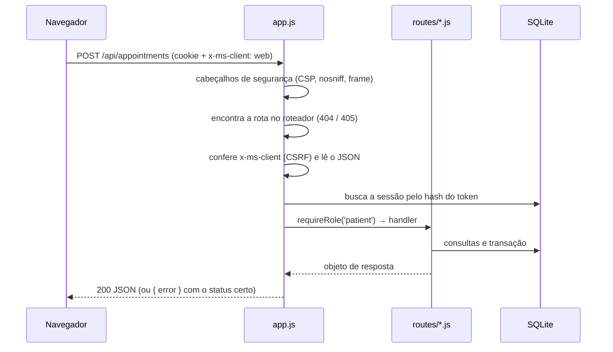
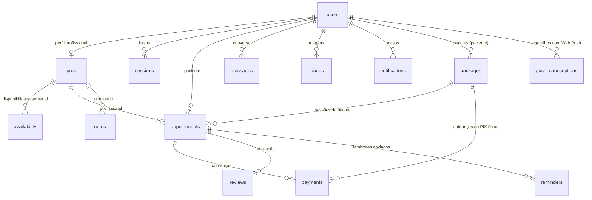
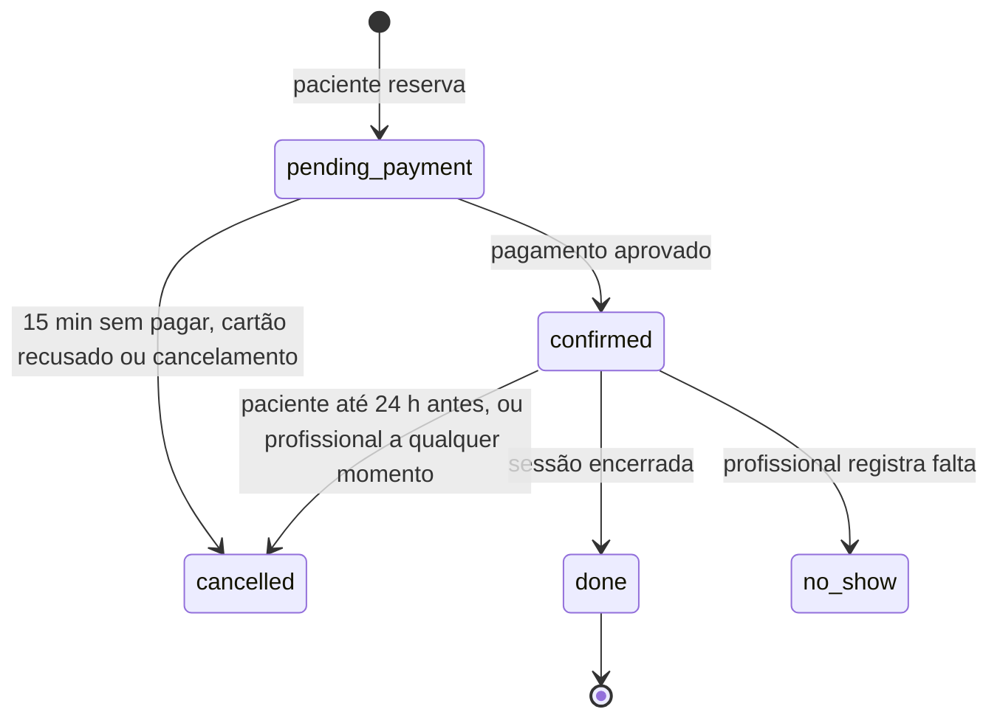

# Documentação técnica do MVP Me Salva

Este documento cobre a **versão 1.2** (app instalável no celular, avisos com o app fechado e agendamento recorrente), que se soma à 1.1 (chat em tempo real, central de notificações e lembretes de sessão). O que mudou em cada versão está no [CHANGELOG](../CHANGELOG.md).

Ele explica como o código do MVP está organizado, como as partes conversam entre si e onde mexer para fazer as mudanças mais comuns. Para rodar o projeto, publicar e usar as contas de demonstração, veja o [README](../README.md).

Todos os dados de demonstração são fictícios, e o pagamento é simulado.

## Sumário

1. [Visão geral](#1-visão-geral)
2. [Tecnologias e decisões](#2-tecnologias-e-decisões)
3. [Estrutura de pastas](#3-estrutura-de-pastas)
4. [Servidor](#4-servidor)
5. [Interface](#5-interface)
6. [Modelo de dados](#6-modelo-de-dados)
7. [Regras de negócio](#7-regras-de-negócio)
8. [API completa](#8-api-completa)
9. [Segurança e LGPD](#9-segurança-e-lgpd)
10. [Dados de demonstração](#10-dados-de-demonstração)
11. [Testes](#11-testes)
12. [Como fazer mudanças comuns](#12-como-fazer-mudanças-comuns)
13. [Limitações conhecidas](#13-limitações-conhecidas)
14. [Glossário](#14-glossário)

## 1. Visão geral

O Me Salva conecta pacientes e famílias a profissionais de saúde mental verificados. O MVP cobre a jornada inteira de três perfis:

| Perfil | O que faz no MVP |
|---|---|
| Paciente (`patient`) | Faz a triagem, busca profissionais, agenda sessões avulsas ou pacotes recorrentes, paga (PIX ou cartão simulados), conversa no chat em tempo real, recebe notificações e lembretes (também com o app fechado), entra na sala de vídeo, avalia a sessão, assina o Me Salva+ e instala o app no celular |
| Profissional (`pro`) | Acompanha o painel, gerencia agenda e horários (com os pacientes recorrentes marcados), configura vagas sociais, conversa com pacientes, recebe notificações e lembretes e escreve no prontuário criptografado |
| Administração (`admin`) | Vê indicadores, aprova ou recusa registros profissionais, restaura os dados de demonstração e dispara lembretes na demonstração |

É uma aplicação web única: o mesmo servidor entrega a API (`/api/...`) e os arquivos da interface (`public/`). A interface funciona no computador e no celular e, desde a v1.2, pode ser instalada como app (PWA).

## 2. Tecnologias e decisões

| Escolha | Por quê |
|---|---|
| **Node.js 22.13+ sem dependências** | O projeto roda com `npm start` logo após o clone, sem `npm install`. Usa só módulos nativos: `node:http`, `node:sqlite` e `node:crypto`. |
| **SQLite embutido** (`node:sqlite`) | Banco relacional de verdade, num único arquivo (`data/mesalva.db`), sem servidor separado. |
| **JavaScript puro no navegador** (módulos ES) | Sem etapa de build. Cada tela é uma função que devolve HTML. |
| **Horários como texto local de São Paulo** | Sessões são gravadas como `'AAAA-MM-DDTHH:MM'` no fuso de São Paulo, então um servidor em UTC mostra os mesmos horários que o usuário vê (`src/time.js`). |
| **Dinheiro em centavos** | Todos os valores são inteiros em centavos, para evitar erros de arredondamento. |
| **Tempo real com Server-Sent Events (SSE)** | SSE é um fluxo em que o navegador abre uma conexão HTTP comum e o servidor vai escrevendo avisos nela, sempre numa direção (servidor → navegador). Escolhemos SSE e não WebSocket porque o servidor só precisa empurrar avisos; o envio continua pelas rotas POST de sempre, com a proteção CSRF; o navegador já traz o `EventSource` com reconexão automática; passa por proxies e por HTTP/2; e não precisa de nenhuma dependência. |
| **Regras de negócio em funções puras** | Horários (`slots.js`), preço (`pricing.js`), emparelhamento (`matching.js`) e recorrência (`recurrence.js`) não acessam o banco, o que facilita testar. |
| **App instalável (PWA) em vez de app nativo** | Um service worker e um manifesto bastam para o site virar app na tela inicial do Android e do iPhone, com tela cheia e avisos do sistema, sem loja de aplicativos e sem um segundo código. O app nativo (React Native) continua no plano do PIPE. |
| **Versão do service worker calculada pelo servidor** | O servidor monta `/sw.js` com a versão do `package.json` mais um resumo (hash) de `public/`. Qualquer arquivo alterado gera um service worker novo, e o cache antigo é apagado: ninguém precisa lembrar de trocar um número de versão. |
| **Web Push implementado com `node:crypto`** | A criptografia do aviso (RFC 8291) e a assinatura VAPID (RFC 8292) usam só ECDH P-256, HKDF, AES-128-GCM e ECDSA, que já vêm no Node. Assim o projeto continua sem dependências. A implementação é conferida com o exemplo oficial da RFC num teste. |
| **Pacote = várias sessões comuns** | Cada sessão de um pacote recorrente é uma linha de `appointments`, com o próprio preço e o próprio pagamento. Cancelamento, lembretes, sala de vídeo, avaliação, painel e reembolso funcionam sem mudança; o pacote só agrupa e guarda o PIX único. |

A troca de SQLite por PostgreSQL e da interface por um aplicativo React Native está prevista na Fase 1 do PIPE.

## 3. Estrutura de pastas

```
me-salva-mvp/
├── server.js                 ponto de entrada: abre o banco, cria dados demo se vazio, liga os lembretes, sobe o HTTP
├── CHANGELOG.md              histórico das versões
├── package.json              versão e scripts start, dev, seed e test (sem dependências)
├── .env.example              variáveis de ambiente opcionais
├── Dockerfile · render.yaml  publicação em Docker ou no Render
├── src/                      servidor
│   ├── config.js             leitura das variáveis de ambiente
│   ├── app.js                monta a aplicação: segurança, CSRF, sessão, rotas, arquivos estáticos
│   ├── http.js               mini-framework: roteador, leitura de JSON, cookies, arquivos estáticos
│   ├── guards.js             requireUser e requireRole (controle de acesso)
│   ├── db.js                 esquema do banco e interface all/get/run/tx/afterCommit
│   ├── services.js           consultas reaproveitadas (profissionais, horários, chat, notificações, auditoria)
│   ├── realtime.js           distribuidor de eventos em tempo real (SSE): conexões por usuário e sinal de vida
│   ├── reminders.js          lembretes de sessão 24 h e 1 h antes
│   ├── recurrence.js         pacotes recorrentes: datas, conflitos e sugestão do horário livre mais próximo (v1.2)
│   ├── pwa.js                monta o service worker com a versão e a lista de arquivos atuais (v1.2)
│   ├── push.js               Web Push: chaves VAPID, criptografia do aviso e envio (v1.2)
│   ├── time.js               datas no fuso de São Paulo
│   ├── validate.js           validação de entradas com mensagens em português
│   ├── security.js           scrypt, tokens, AES-256-GCM, limite de tentativas, PIX, Luhn
│   ├── pricing.js            valor da sessão e divisão plataforma/profissional
│   ├── slots.js              disponibilidade semanal → horários e vagas sociais
│   ├── matching.js           triagem → necessidades → ranking com motivos
│   ├── seed.js               dados de demonstração (também roda com `npm run seed`)
│   └── routes/
│       ├── auth.js           cadastro, entrada, saída, contas demo
│       ├── me.js             conta, Me Salva+, exportação e exclusão (LGPD)
│       ├── catalog.js        dados de referência, busca, perfil, horários, triagem
│       ├── appointments.js   reserva, pagamento, cancelamento (inclusive "esta e as próximas"), sala, encerramento, avaliação
│       ├── packages.js       pacotes recorrentes: prévia, criação com PIX único, consulta e pagamento (v1.2)
│       ├── push.js           chave pública e inscrição do Web Push (v1.2)
│       ├── messages.js       conversas, mensagens de texto e áudio, "digitando…" e "visto"
│       ├── pro.js            painel, perfil, disponibilidade, vagas sociais, prontuário
│       ├── admin.js          indicadores, verificação de registros, restauração dos dados, lembretes da demonstração
│       ├── realtime.js       GET /api/stream (canal em tempo real)
│       └── notifications.js  lista e leitura das notificações
├── public/                   interface (servida como arquivos estáticos)
│   ├── index.html            casca da página: barra lateral, tela, abas, camadas, metas do iPhone
│   ├── offline.html          página mostrada sem internet, com o CVV 188 (v1.2)
│   ├── manifest.webmanifest  nome, ícones, cores e atalhos do app instalável
│   ├── sw.js                 service worker: cache da estrutura, página offline e avisos do sistema (v1.2)
│   ├── icons/                ícones PNG e SVG, apple-touch-icon e telas de abertura do iPhone (v1.2)
│   ├── css/styles.css        estilos (tema claro e escuro, computador e celular)
│   └── js/
│       ├── theme.js          aplica o tema salvo antes de desenhar
│       ├── app.js            inicialização e delegação de eventos
│       ├── realtime.js       EventSource da aba, reconexão, vigia e reserva por consulta periódica
│       ├── pwa.js            registro do service worker, "Instalar o app", faixa sem internet, avisos e Web Push (v1.2)
│       ├── core.js           estado, chamadas à API, navegação, menus, ícones, formatação
│       ├── shared/data.js    áreas, bairros, temas, preços e textos da triagem (usado também pelo servidor)
│       └── screens/
│           ├── common.js     entrada, login, cadastro, configurações, chat, sala de vídeo
│           ├── notifications.js  painel do sino, avisos do sistema e convite para ativá-los
│           ├── patient.js    início, busca, perfil, agendamento (com "Repetir"), pagamento, agenda, triagem, avaliação, planos
│           ├── packages.js   PIX do pacote, tela do pacote, cartão agrupado na agenda e cancelamento (v1.2)
│           └── pro.js        painel, agenda, horários, perfil, prontuário e administração
├── test/
│   ├── domain.test.js        regras puras (horários, preço, emparelhamento, segurança)
│   ├── api.test.js           fluxo completo pela API com banco temporário
│   ├── realtime.test.js      tempo real, notificações e lembretes
│   ├── pwa.test.js           service worker, manifesto, ícones, página offline (v1.2)
│   ├── recurrence.test.js    agendamento recorrente (v1.2)
│   └── push.test.js          Web Push (v1.2)
├── scripts/icones.mjs        gera os ícones e as telas de abertura a partir do logo (opcional, precisa do rsvg-convert)
├── docs/
│   ├── DOCUMENTACAO.md       este documento
│   └── img/                  capturas de tela
└── data/                     criada na primeira execução: mesalva.db, notes.key e vapid.json (fora do Git)
```

## 4. Servidor

### 4.1 Caminho de uma requisição



Pontos importantes:

- **Rotas** são registradas por arquivos em `src/routes/`. Cada arquivo exporta uma função `(router, ctx)`, chamada uma vez em `createApp`. O `ctx` traz `db`, `config`, `svc` (serviços) e `notesKey`.
- **Handlers em sequência**: `r.get('/api/pro/dashboard', requireRole('pro'), handler)`. A guarda lança erro se o acesso não for permitido; o handler devolve um objeto, que vira JSON.
- **Erros**: as rotas lançam `HttpError(status, mensagem)` ou usam `bad(mensagem)` (400). A mensagem chega pronta para aparecer na tela. Erros inesperados vão para o log e o usuário recebe uma mensagem genérica.
- **Arquivos estáticos**: qualquer caminho fora de `/api/` é procurado em `public/`. Se não existir, o servidor devolve `index.html`, e a interface decide a tela. A exceção é `/sw.js`, montado pelo servidor (seção 4.5).

### 4.2 Serviços compartilhados (`services.js`)

| Função | Para que serve |
|---|---|
| `getPro(id)` / `listPros(where)` | Profissional com nota média e número de avaliações |
| `template(id)` | Disponibilidade semanal do profissional |
| `slotsFor(pro)` | Horários dos próximos 14 dias, já sem reservas vencidas |
| `expirePending()` | Cancela reservas não pagas há mais de 15 minutos |
| `pushMessage(...)` | Grava mensagem no chat (inclusive avisos automáticos), cria a notificação de quem recebeu e empurra a mensagem em tempo real depois do COMMIT |
| `unreadCount(user)` | Número de mensagens não lidas |
| `notify(userId, {...})` | Cria uma notificação e a empurra em tempo real e, desde a v1.2, por Web Push para os aparelhos inscritos. Com `ref`, reaproveita a notificação do mesmo assunto (ela volta a ficar não lida e sobe para o topo) |
| `readChatNotifications(userId, otherId)` | Marca como lidas as notificações de mensagem de uma conversa |
| `counts(userId)` / `sendCounts(userId)` | Contadores de mensagens e de notificações não lidas; `sendCounts` os envia a todas as abas do usuário |
| `messageView(m)` / `notificationView(n)` | Formato de mensagem (com o campo `seen`) e de notificação enviado ao navegador |
| `roomOpen(appt)` | Se a sala de vídeo já pode ser aberta |
| `patientBusy(id, de, até)` | Horários das sessões ativas do paciente no período, com qualquer profissional (usado na recorrência) |
| `packageView(pacote)` | Resumo de um pacote recorrente: padrão em texto ("seg e qua, 08:00"), contagens, valores e nomes |
| `audit(user, ação, alvo)` | Registro na trilha de auditoria |

### 4.3 Tempo real (SSE)

O arquivo `src/realtime.js` cria o distribuidor de eventos (`createHub`), e a rota `GET /api/stream` (`src/routes/realtime.js`) abre o fluxo para o usuário logado, identificado pelo cookie de sessão como nas outras rotas. Cada aba aberta mantém uma conexão.

- **Conexões por usuário**: o distribuidor guarda as conexões de cada usuário na memória do servidor. O máximo é de 8 abas por usuário; quando passa disso, a conexão mais antiga é fechada.
- **Sinal de vida (`ping`)**: a cada 25 segundos o servidor manda um `ping`, que também evita que proxies cortem a conexão parada. Nesse momento ele confere se a sessão de cada conexão ainda existe e não venceu; se não, fecha a conexão.
- **Fechamento imediato**: sair da conta (logout), excluir a conta e "Restaurar dados de demonstração" fecham as conexões na hora.
- **Só depois do COMMIT**: `db.afterCommit(fn)` (em `src/db.js`) guarda a função durante uma transação e a executa só depois do COMMIT; numa transação desfeita (ROLLBACK), ela é descartada. Assim nenhum evento anuncia um dado que acabou não sendo gravado. Fora de uma transação, a função roda na hora.

Eventos enviados:

| Evento | Dados | Quando |
|---|---|---|
| `hello` | `{ messages, notifications }` | Ao conectar ou reconectar, com os contadores atuais |
| `counts` | `{ messages, notifications }` | Quando algum contador de não lidas muda |
| `message` | `{ conversation, message }` | Mensagem nova, para as duas pessoas da conversa; `conversation` é o id da outra pessoa, do ponto de vista de quem recebe |
| `typing` | `{ conversation }` | A outra pessoa está digitando |
| `read` | `{ conversation, upTo }` | A outra pessoa abriu a conversa; as mensagens até o id `upTo` foram vistas |
| `notification` | `{ notification }` | Notificação nova ou atualizada |
| `ping` | `{ t }` | Sinal de vida, a cada 25 s |

**Regra de segurança**: o destinatário de um evento é sempre um id de usuário decidido pelo servidor a partir do banco, nunca um valor enviado pelo navegador. Uma conexão só recebe eventos do próprio usuário, e uma mensagem vai só para as duas pessoas da conversa.

### 4.4 Lembretes

O arquivo `src/reminders.js` manda um lembrete 24 horas e outro 1 hora antes de cada sessão confirmada. O `server.js` liga a conferência: ela roda ao iniciar e depois a cada minuto.

- A cada conferência, o servidor olha as sessões confirmadas que começam nas próximas 24 horas.
- Se faltam mais de 60 minutos, vale o lembrete de 24 h; se faltam 60 minutos ou menos, vale o de 1 h. Só o mais próximo vale: quem marca em cima da hora recebe apenas o de 1 h.
- A tabela `reminders` tem a chave (`appointment_id`, `kind`), com `kind` igual a `24h` ou `1h`. Ela garante que o mesmo lembrete nunca seja enviado duas vezes, mesmo que a conferência rode de novo ou o botão da demonstração seja apertado várias vezes.
- Cada lembrete gera uma mensagem automática no chat da sessão (por exemplo, "Lembrete: a sessão é hoje (17/11) às 13:00, online. A sala abre 15 minutos antes do horário.") e uma notificação para o paciente e outra para o profissional. A sala só é mencionada nas sessões online.
- Os textos de data usam `whenText` (em `src/time.js`): "hoje (17/11) às 13:00", "amanhã (18/11) às 10:00" ou "qua, 25/11 às 09:00".
- **Modo demonstração**: a administração tem o botão "Disparar lembretes agora" (`POST /api/admin/reminders/run`, só para a administração e só com `DEMO_MODE=true`). Ele antecipa o lembrete de 1 h das sessões que começam nas próximas 3 horas.

### 4.5 App instalável (service worker)

O arquivo `public/sw.js` é um modelo com duas marcas, `__VERSION__` e `__SHELL__`. Ao atender `/sw.js`, o servidor (`src/pwa.js`) troca as marcas pela versão (a do `package.json` mais os 10 primeiros caracteres de um SHA-256 de todos os arquivos de `public/`) e pela lista de arquivos da estrutura do app. O resultado fica guardado e só é recalculado quando algum arquivo muda de tamanho ou de data. A resposta tem `Cache-Control: no-cache`, para o navegador sempre conferir se há versão nova, e uma CSP própria que só acrescenta as fontes do Google ao `connect-src`.

O que o service worker faz:

| Pedido | Estratégia |
|---|---|
| `/api/...` (inclusive `/api/stream`) e qualquer envio (POST, PUT…) | Passa direto para a rede. Nada da API vai para o cache. |
| Abrir o app (navegação) | Rede primeiro, para pegar a versão mais nova; sem internet, `offline.html`. |
| CSS, JavaScript, ícones e manifesto | Do cache da versão atual (`ms-shell-<versão>`); o que não estiver lá vem da rede. |
| Fontes do Google | Cache próprio (`ms-fonts-1`), que sobrevive às versões. |

- **Instalação e troca de versão**: ao instalar, baixa a estrutura com `cache: 'reload'` (ignora o cache HTTP) e assume na hora (`skipWaiting`); ao ativar, apaga os caches de versões anteriores e passa a controlar as abas abertas (`clients.claim`). As abas abertas continuam com os arquivos que já carregaram; a próxima abertura usa a versão nova.
- **Ficam fora do cache**: o próprio `sw.js`, o `index.html` (a navegação vai pela rede) e as telas de abertura do iPhone (o iPhone baixa só a do seu tamanho, ao instalar).
- **Avisos do sistema**: o evento `push` mostra o aviso (salvo quando há uma aba do Me Salva à vista, que já mostra o toast), e `notificationclick` traz o app para a frente e manda a mensagem `ms-open` para a página abrir a tela certa; com o app fechado, abre `/?tela=...&p=...&n=...`.
- **Registro**: `public/js/pwa.js` registra o service worker depois que a interface abre, só em HTTPS ou em `http://localhost` (exigência dos navegadores).

### 4.6 Web Push (avisos com o app fechado)

`src/push.js` entrega cada notificação aos aparelhos inscritos, sem dependências.

1. **Inscrição**: com a permissão de avisos dada, a interface pede a chave pública do servidor (`GET /api/push/key`), inscreve o aparelho no serviço de push do navegador (`pushManager.subscribe`) e manda o endereço e as chaves da inscrição para `POST /api/push/subscribe`. A tabela `push_subscriptions` guarda uma linha por aparelho; se o aparelho estava em outra conta, a inscrição passa para a conta atual. Cada pessoa tem no máximo 10 aparelhos (sai o mais antigo).
2. **Envio**: `svc.notify`, depois do COMMIT, chama `push.sendTo(usuário, notificação)`, que roda em segundo plano. Para cada aparelho, o aviso (`{ id, title, body, screen, param, kind }`) é criptografado com `aes128gcm` (RFC 8291: ECDH P-256 com uma chave temporária, HKDF e AES-128-GCM) e enviado por HTTPS com o cabeçalho `Authorization: vapid t=<JWT ES256>, k=<chave pública>` (RFC 8292), `TTL` de 24 horas, `Urgency` alta para lembretes e `Topic` com o id da notificação (avisos do mesmo assunto se substituem enquanto o aparelho está desligado).
3. **Respostas**: 201 é entregue; 404 ou 410 quer dizer que a inscrição não existe mais, e ela é apagada; outros códigos vão para o log.
4. **Desinscrição**: sair da conta, excluir a conta ou desligar "Avisos do aparelho" chama `POST /api/push/unsubscribe` e cancela a inscrição no navegador.

**Chaves VAPID**: vêm de `VAPID_PUBLIC_KEY` e `VAPID_PRIVATE_KEY` (base64url) ou são geradas uma vez em `data/vapid.json` (permissão só do dono). Se mudarem, as inscrições antigas deixam de valer; o app percebe a chave diferente e se inscreve de novo na próxima abertura. `PUSH=off` desliga o envio.

**Segurança**: só são aceitos endereços HTTPS, na porta padrão, dos serviços de push conhecidos (`fcm.googleapis.com`, `android.googleapis.com`, `*.push.services.mozilla.com`, `*.push.apple.com` e `*.notify.windows.com`). Sem essa lista, alguém poderia cadastrar um endereço qualquer e fazer o servidor acessá-lo (SSRF). O aviso vai criptografado para o aparelho; o serviço do fabricante não lê o conteúdo. Como na v1.1, o texto das mensagens do chat nunca entra na notificação.


## 5. Interface

A interface é uma aplicação de página única, em JavaScript puro.

- **Registro de telas** (`core.js`): cada tela é registrada com `screen(nome, { load, view, after, nav, tabs, width, bare })`. `load` busca os dados, `view` devolve o HTML e `after` roda depois de desenhar.
- **Navegação em pilha**: `go(tela, parâmetro)` abre uma tela por cima, `back()` volta, `tab(tela)` recomeça a pilha (itens do menu) e `replace` troca a tela atual.
- **Eventos por delegação** (`app.js`): o HTML não tem `onclick`. Botões usam `data-a="nomeDaAcao"` (funções em `A`), formulários usam `data-f` (funções em `F`) e campos usam `data-i` (funções em `I`). Isso permite a CSP sem scripts inline.
- **Camadas**: folhas sobrepostas (confirmação, filtros, ajuda imediata, carregando) usam `openLayer(tipo, dados)` e as funções em `LAYERS`.
- **Tempo real** (`public/js/realtime.js`): cada aba abre um `EventSource` em `/api/stream`. As telas se inscrevem nos eventos com `onLive(evento, função)`; o evento interno `_open` avisa que o canal (re)conectou, para a tela buscar o que chegou durante a queda. Se o canal cai, o navegador tenta de novo em 3 segundos; se o servidor recusa a conexão, a interface tenta de novo com uma espera que dobra de 3 s até 30 s. Um vigia reabre a conexão se ela ficar 60 segundos sem nenhum dado, e ao voltar para a aba a conexão é reaberta se tiver caído.
- **Reserva (consulta periódica)**: enquanto o canal não está aberto (`S.live` é falso), a interface volta ao que a v1.0 fazia: o chat aberto busca mensagens novas a cada 3 segundos, e os contadores de não lidas são consultados a cada 15 segundos.
- **Chat em tempo real** (`screens/common.js`): a mensagem nova aparece na hora dos dois lados; a lista de conversas e os contadores se atualizam sozinhos, sem apagar o que está sendo digitado. Com a aba em segundo plano, a conversa aberta não marca como lida; marca quando a pessoa volta.
- **Sino e painel** (`screens/notifications.js`): o sino com contador fica na barra lateral (computador) e nos cabeçalhos das telas principais do celular; ele não aparece para a administração. O painel abre à direita (tela cheia no celular), tem "Marcar todas como lidas" e, ao clicar numa notificação, marca como lida e abre a tela certa (conversa, agenda, painel ou perfil). Com o painel fechado e a aba à vista, chega um aviso rápido (toast).
- **Aviso do sistema (notificação do navegador)**: com a aba em segundo plano, a própria página mostra o aviso; com o app fechado, ele chega por Web Push (seção 4.6). Precisa da permissão concedida e da preferência ligada. A permissão só é pedida por um clique: no convite da tela "Sessão agendada!" (que some de vez com "Agora não"), no fim do painel do sino e em Configurações → Avisos do aparelho, que liga e desliga neste aparelho (guardado em `localStorage`, na chave `ms-notify`) e inscreve ou desinscreve o Web Push. A etiqueta (`tag`) do aviso é `ms-<id da notificação>` em todos os caminhos (página, push e todas as abas), então aparece um aviso só.
- **App instalável** (`public/js/pwa.js`): registra o service worker, guarda o evento `beforeinstallprompt` (o navegador não abre a janela sozinho) e mostra o botão "Instalar o app" em Configurações e o convite discreto na tela inicial do paciente e no painel do profissional (some de vez com "Agora não", guardado em `localStorage`, chave `ms-install-later`). No iPhone, o botão abre o passo a passo Compartilhar → Adicionar à Tela de Início. Aberto como app (`display-mode: standalone`), Configurações mostra "instalado".
- **Atalhos e avisos com o app fechado**: `/?tela=agenda`, `/?tela=chats` e `/?tela=crise` (atalhos do manifesto) e `/?tela=chat&p=12&n=40` (toque num aviso) abrem a tela certa ao iniciar, só entre as telas do perfil de quem está logado. A ajuda imediata abre mesmo sem login. O endereço volta para `/`.
- **Botão Voltar do aparelho** (`core.js`): enquanto há tela empilhada ou folha aberta, a interface mantém uma entrada extra no histórico do navegador; o Voltar do Android (ou do navegador) a consome e vira `back()` ou `closeLayer()`, em vez de fechar o app.
- **Sem internet**: uma faixa no topo avisa e oferece "Ajuda: 188"; abrir o app sem rede mostra `offline.html`.
- **Avisos do sistema**: saem por `registration.showNotification` (o único caminho no Android e no iPhone), com o ícone e o ícone pequeno de barra de status (`icons/badge-96.png`).
- **Repetir** (`screens/patient.js`): na tela de agendamento, depois de escolher o horário. Os dias oferecidos são os da semana em que o profissional tem aquele horário na grade das próximas 2 semanas. Cada mudança (horário, dias ou semanas) busca a prévia em `/api/pros/:id/recurrence`; as datas com conflito aparecem com "Usar 14:00" ou "Pular data", e o resumo lista as sessões por valor. O estado fica em `S.bk.rep`.
- **Pacotes** (`screens/packages.js`): tela do PIX do pacote (`pixpacote`), tela do pacote (`pacote`, também aberta pelo profissional pela marca "recorrente"), cartão agrupado na agenda do paciente e a folha "Cancelar só esta sessão / Cancelar esta e as próximas".
- **Layout**: a partir de 960 px de largura, a interface usa barra lateral; abaixo disso, abas inferiores de aplicativo. Com o app em tela cheia, o conteúdo respeita as áreas seguras (`env(safe-area-inset-*)`).
- **Tema**: claro por padrão; o escuro é ligado em Configurações e lembrado no navegador.
- **Segurança**: todo texto vindo da API passa por `esc()` antes de entrar no HTML.

Telas por arquivo:

| Arquivo | Telas |
|---|---|
| `screens/common.js` | `entrada`, `login`, `cadastro`, `config`, `chats`, `chat`, `sessao` |
| `screens/notifications.js` | Sem tela própria: painel do sino (camada `notifs`), avisos do sistema, convite e linha de Configurações |
| `screens/patient.js` | `home`, `areas`, `busca`, `perfil`, `agendar`, `pagamento`, `pix`, `confirmado`, `agenda`, `avaliar`, `triagem`, `trires`, `planos` |
| `screens/packages.js` | `pixpacote`, `pacote` e a camada `packCancel` |
| `screens/pro.js` | `painel`, `proagenda`, `horarios`, `properfil`, `prontuario`, `admin` |

## 6. Modelo de dados



| Tabela | Campos principais | Observações |
|---|---|---|
| `users` | `role`, `name`, `email`, `pass_hash`, `bairro`, `plan` | `role` é `patient`, `pro` ou `admin`; `plan` é `free` ou `plus` |
| `sessions` | `token_hash`, `user_id`, `expires_at` | Guarda só o hash SHA-256 do token; vale 7 dias |
| `pros` | `area`, `reg`, `topics`, `audience`, `modalities`, `price`, `is_new`, `supervisor`, `social_price`, `social_weekly`, `auto_fill`, `status` | `status` é `pending`, `verified` ou `rejected`; listas em JSON |
| `availability` | `pro_id`, `weekday`, `hour` | Um registro por horário semanal (0 = domingo) |
| `appointments` | `package_id`, `start`, `modality`, `social`, `base_price`, `amount`, `fee`, `pro_amount`, `status`, `room`, `expires_at` | Índice único `appt_slot` impede duas reservas ativas no mesmo horário; `package_id` (v1.2) liga a sessão ao pacote recorrente |
| `payments` | `package_id`, `kind`, `method`, `amount`, `fee`, `pro_amount`, `status`, `pix_code`, `card_last4` | `kind` é `session` ou `plus`; `status`: `pending`, `paid`, `refunded`, `expired`, `failed`; nas sessões de pacote, há uma cobrança por sessão, todas com o `package_id`, pagas juntas pelo PIX do pacote |
| `packages` | `patient_id`, `pro_id`, `weekdays`, `time`, `weeks`, `modality`, `amount`, `status`, `pix_code`, `expires_at`, `paid_at` | v1.2. `weekdays` em JSON (0 = domingo); `time` é o horário escolhido; `amount` é o total do PIX; `status`: `pending`, `paid`, `expired` ou `cancelled` |
| `push_subscriptions` | `user_id`, `endpoint` (único), `p256dh`, `auth` | v1.2. Uma linha por aparelho inscrito no Web Push |
| `messages` | `patient_id`, `pro_id`, `sender_id`, `kind`, `body`, `audio`, `read_by_*` | `kind` é `text`, `audio` ou `system`; áudio guardado como data URL |
| `reviews` | `appointment_id` (único), `rating`, `tags`, `text`, `author_label` | Uma por sessão realizada |
| `triages` | `answers`, `needs` | Respostas e critérios derivados, em JSON |
| `notes` | `pro_id`, `patient_id`, `iv`, `tag`, `data` | Texto do prontuário criptografado com AES-256-GCM |
| `audit` | `user_id`, `action`, `target` | Ex.: `login`, `notes.read`, `pro.verified`, `data.export` |
| `notifications` | `user_id`, `kind`, `title`, `body`, `screen`, `param`, `ref`, `read_at`, `created_at` | `kind` é `message`, `confirmed`, `cancelled`, `reminder`, `review`, `verified` ou `rejected`; `screen` e `param` dizem qual tela abrir ao clicar; `ref` agrupa avisos do mesmo assunto (`chat:12`); `read_at` fica vazio enquanto não lida |
| `reminders` | `appointment_id`, `kind`, `sent_at` | Chave (`appointment_id`, `kind`), com `kind` igual a `24h` ou `1h`: impede lembrete repetido |

O esquema fica em `src/db.js`. Como ele usa `CREATE TABLE IF NOT EXISTS`, uma tabela nova é criada sozinha num banco que já existe. Uma coluna nova não seria; por isso a v1.2 trouxe uma lista de colunas acrescentadas (`ADDED_COLUMNS`): ao abrir o banco, `migrate()` confere cada uma com `PRAGMA table_info` e, se faltar, roda `ALTER TABLE ... ADD COLUMN`. Assim, bancos da v1.0 e da v1.1 ganham `package_id` em `appointments` e em `payments` sem perder dados. Uma regra `CHECK` nova continua exigindo apagar `data/mesalva.db`. O "visto" do chat usa os campos `read_by_patient` e `read_by_pro` que já existiam.

## 7. Regras de negócio

### 7.1 Ciclo de uma sessão



- Ao confirmar, o sistema cria o nome da sala de vídeo e manda um aviso automático no chat. As sessões de um pacote recorrente seguem o mesmo ciclo, cada uma com o seu status (seção 7.7).
- Cancelamento de sessão paga devolve o valor (`payments.status = refunded`) e avisa no chat.
- A sala de vídeo abre 15 minutos antes e fecha 60 minutos depois do início. No modo demonstração (`DEMO_MODE=true`), fica aberta no dia todo.

### 7.2 Horários e vagas sociais (`slots.js`)

- Os horários dos próximos 14 dias são gerados a partir da disponibilidade semanal do profissional.
- Horários que começam em menos de 1 hora não são oferecidos.
- **Vagas sociais** só existem para profissionais recém-formados (`is_new`) com supervisor cadastrado e valor social definido (R$ 40 a R$ 80, abaixo do valor normal).
- As primeiras N vagas de cada semana (de segunda a domingo) são sociais, onde N é `social_weekly` (0 a 12).
- Com o **preenchimento automático** ligado, qualquer horário livre nas próximas 24 horas também vira vaga social.

### 7.3 Preço e divisão (`pricing.js`)

O profissional sempre recebe 88% do valor de tabela (ou do valor social). O desconto do Me Salva+ (10%) sai da parte da plataforma.

| Caso (sessão de R$ 100) | Paciente paga | Profissional recebe | Plataforma fica com |
|---|---|---|---|
| Plano gratuito | R$ 100,00 | R$ 88,00 | R$ 12,00 |
| Me Salva+ | R$ 90,00 | R$ 88,00 | R$ 2,00 |
| Vaga social de R$ 45, plano gratuito | R$ 45,00 | R$ 39,60 | R$ 5,40 |

Os percentuais e preços ficam em `PRICING`, no arquivo `public/js/shared/data.js`.

### 7.4 Triagem e emparelhamento (`matching.js`)

**1. Necessidades.** `deriveNeeds(respostas)` transforma as respostas leigas em critérios:

| Situação | Áreas indicadas (peso de 0 a 1) | Outros critérios |
|---|---|---|
| Criança com TEA confirmado | ABA 1 · Terapia ocupacional 0,5 · Psicologia 0,4 | Tema TEA; sinais viram temas (comunicação, rotina, integração sensorial…); apoio "muito" → alta frequência |
| Criança em investigação ou sem diagnóstico | Neuropsicologia 1 · Psiquiatria 0,9 · ABA 0,6 · Psicologia 0,3 | Mesmo tratamento dos sinais |
| Adulto | Psicologia 1 · Psicanálise 0,5 (0,9 se "autoconhecimento") · Psiquiatria 0,7 se TDAH | Motivos viram temas; sintomas intensos → urgência e psiquiatria 0,9 |

Também entram público (crianças, adolescentes ou adultos), modalidade, orçamento máximo e períodos do dia.

**2. Restrições obrigatórias.** Fica de fora quem não é de uma área indicada, não atende o público, não tem horário livre em 14 dias, não atende na modalidade escolhida ou custa mais que o orçamento (considerando a vaga social livre). Se sobrarem menos de 3 opções, a busca é ampliada: primeiro o orçamento e depois a modalidade. O cartão avisa o que não foi atendido.

**3. Pontuação.** Cada critério vira um número de 0 a 1, e a nota final (0 a 100) é a média ponderada:

| Critério | Peso | Como é medido |
|---|---|---|
| Área | 30 | Peso da área na tabela acima |
| Temas | 22 | Temas da triagem presentes no perfil (até 3) |
| Avaliação | 14 | Nota bayesiana: com poucas avaliações, a nota é puxada para 4,0 |
| Disponibilidade | 12 | Horários livres no período preferido (3 ou mais = máximo) |
| Distância | 10 | Até 20 km, quando o atendimento presencial importa |
| Experiência | 6 | Anos de atuação (10 ou mais = máximo) |
| Orçamento | 6 | Cabe ou não no valor informado |

**4. Ordem e explicação.** Quem atende a todas as restrições vem primeiro; depois vale a nota. Cada indicação mostra os três motivos que mais pesaram, como "Vaga social de R$ 45 cabe no seu orçamento". A rota `/api/triage` devolve as 5 primeiras indicações.

Os pesos são uma versão inicial definida pela equipe e serão revistos com especialistas (atividade A2 do PIPE). Há um teste que garante menos de 300 ms com 10 mil perfis.

### 7.5 Outras regras

| Tema | Regra |
|---|---|
| Cadastro de profissional | Registro precisa começar com o conselho da área (CRP, CRM ou CREFITO); recém-formado precisa informar supervisor; valor entre R$ 40 e R$ 1.000 |
| Verificação | Profissional novo fica `pending` e não aparece na busca até a administração aprovar |
| Reserva | Horário fica guardado por 15 minutos até o pagamento; o servidor recalcula horário e preço |
| Cartão de teste | 4242 4242 4242 4242 é aprovado; 4000 0000 0000 0002 é recusado e libera o horário |
| Avaliação | Só depois de sessão realizada, uma por sessão, nota de 1 a 5, destaques, comentário de até 600 caracteres e opção anônima |
| Chat | Profissional só conversa com quem tem ou teve sessão com ele; áudio de até cerca de 1 minuto; o "digitando…" segue a mesma regra |
| Prontuário | Só para pacientes da agenda do profissional; toda leitura e escrita vai para a auditoria |
| Disponibilidade | Horários cheios das 07:00 às 21:00, de domingo a sábado |
| Ocupação no painel | Sessões ocupadas ÷ horários oferecidos pela disponibilidade atual, mês a mês, até hoje |

### 7.6 Notificações e lembretes

Cada notificação fica na tabela `notifications` e é empurrada em tempo real para as abas de quem a recebe.

| Tipo (`kind`) | Quando | Quem recebe | Tela que abre |
|---|---|---|---|
| `message` | Chega mensagem de texto ou áudio | Quem recebeu a mensagem | Conversa (`chat`) |
| `confirmed` | Pagamento aprovado e sessão (ou pacote) confirmada | Paciente e profissional | Agenda (`agenda`), tela do pacote (`pacote`) ou agenda do profissional (`proagenda`) |
| `cancelled` | Sessão confirmada é cancelada (ou várias, com "esta e as próximas") | Só o outro lado: quem cancelou não recebe | `agenda` ou `proagenda` |
| `reminder` | 24 h ou 1 h antes da sessão (seção 4.4) | Paciente e profissional | `agenda` ou `proagenda` |
| `review` | Paciente avalia a sessão | Profissional | Perfil (`perfil`) |
| `verified` | Administração aprova o registro | Profissional | Painel (`painel`) |
| `rejected` | Administração recusa o registro | Profissional | Meu perfil (`properfil`) |

Regras:

- **Um aviso por conversa**: as mensagens de uma conversa compartilham uma notificação só ("Fernanda Alves enviou 3 mensagens."). A cada mensagem nova, ela volta a ficar não lida e sobe para o topo. Abrir a conversa marca o aviso dela como lido.
- **Sem o texto da mensagem**: o texto nunca entra na notificação, porque o aviso do sistema pode aparecer na tela bloqueada e o assunto é saúde.
- **Visto**: um tique significa enviada, e dois tiques significam vista pela outra pessoa; embaixo da minha última mensagem lida aparece "Visto". A pessoa vê a mensagem quando abre a conversa com a aba à vista; nesse momento o servidor marca como lido e manda o evento `read` ao outro lado. Mensagens do sistema não têm visto.
- **Digitando**: a interface avisa no máximo a cada 2,5 segundos; o servidor repassa no máximo 1 aviso por segundo por conversa; a mensagem "Fulana está digitando…" some 4 segundos depois do último aviso ou quando a mensagem chega.

### 7.7 Agendamento recorrente (`recurrence.js` e `routes/packages.js`)

Terapia ABA costuma ter várias sessões por semana. Em vez de agendar uma por uma, o paciente monta um pacote.

**1. Padrão.** O primeiro horário sai da lista normal (próximas 2 semanas). O paciente escolhe os dias da semana (até 5; o dia do primeiro horário sempre entra) e a duração: 4, 8 ou 12 semanas (`RECURRENCE` em `public/js/shared/data.js`). As datas do pacote são todas as datas, do dia do primeiro horário até o fim do período, que caem nos dias escolhidos, sempre no mesmo horário (`occurrences`). Cada dia escolhido aparece uma vez por semana.

**2. Conferência.** Para cada data (`planPackage`), na ordem:

| Motivo | Quando |
|---|---|
| `unavailable` | O profissional não atende naquele dia e horário, ou é cedo demais para reservar |
| `mine` | O próprio paciente já tem outra sessão ativa a menos de 60 minutos, com qualquer profissional |
| `taken` | O horário do profissional já está reservado por outra pessoa (inclusive aguardando pagamento) |

Para cada data com conflito, a sugestão é o horário livre mais próximo, até 3 dias antes ou depois (`nearestFree`): no mesmo dia, se houver; em empate, o mais cedo. A sugestão nunca bate (menos de 60 minutos) com outra sessão do pacote, com outra sugestão ou com as sessões do paciente.

**3. Escolha e pagamento.** A pessoa decide, para cada conflito, "Usar" a sugestão ou "Pular data"; um pacote precisa de pelo menos 2 sessões. `POST /api/packages` recebe o padrão e a lista final de horários, confere cada um de novo (existe na agenda, está livre, não bate com o paciente nem com outra sessão do pacote e fica no período, com folga de 3 dias) e recalcula cada preço com `quote()`: o navegador não escolhe horários inválidos nem valores. Cria o pacote (`pending`), as sessões (`pending_payment`), uma cobrança por sessão e o PIX do total. O índice `appt_slot` barra duas pessoas no mesmo horário (409). Os horários ficam reservados por 15 minutos; vencido o prazo, `expirePending` cancela as sessões, expira as cobranças e marca o pacote como `expired`.

**4. Confirmação.** `POST /api/packages/:id/pix-simulate` paga todas as cobranças, confirma as sessões, cria as salas, manda **um** aviso no chat ("Pacote confirmado: 8 sessões (ter e qui, 15:00), de 24/11 a 17/12, presencial.", citando as sessões em horário alternativo) e **uma** notificação para cada lado. Os lembretes de 24 h e 1 h valem para cada sessão.

**5. Preço e vagas sociais.** Cada sessão tem o próprio preço, como no agendamento avulso: a vaga social é uma propriedade do horário (as N primeiras vagas da semana do profissional, `socialKeys` em `slots.js`, mais o preenchimento automático das próximas 24 h), então um pacote nunca passa do limite semanal do profissional. O desconto do Me Salva+ vale sessão por sessão. Não há desconto de pacote, para não mudar o modelo de negócio. Exemplo do Rafael (vaga social de R$ 45 nas 4 primeiras vagas da semana, todas na segunda): seg e qua às 08:00 sai por R$ 45 na segunda e R$ 90 na quarta.

**6. Cancelamento.** Continua sessão por sessão, com a regra de 24 h para o paciente (o profissional cancela a qualquer momento) e reembolso. Com `{ "following": true }`, cancela a sessão escolhida e todas as seguintes do mesmo pacote; a regra de 24 h vale para a escolhida (as seguintes são mais tarde). São um aviso só no chat ("Pacote: 4 sessões canceladas pelo paciente (de 01/12 a 17/12). O valor pago será devolvido.") e uma notificação só para o outro lado. Um pacote que ainda aguardava o PIX e ficou sem sessões passa a `cancelled` ("Desistir").

**7. Na interface.** A agenda do paciente agrupa as sessões do mesmo pacote num cartão (padrão, próxima sessão, progresso e "Ver as N sessões"); a agenda e o painel do profissional marcam o paciente como "recorrente".

## 8. API completa

Todas as rotas respondem JSON, exceto `/api/stream`, que responde um fluxo `text/event-stream`. Fora da API, `/sw.js` é o service worker montado pelo servidor. Chamadas que alteram dados (POST, PUT, PATCH, DELETE) precisam do cabeçalho `x-ms-client: web`. Valores em dinheiro vêm em centavos.

| Método | Rota | Quem pode | O que faz |
|---|---|---|---|
| POST | `/api/auth/register` | Qualquer pessoa | Cria conta de paciente ou profissional e já entra |
| POST | `/api/auth/login` | Qualquer pessoa | Entra com e-mail e senha |
| POST | `/api/auth/logout` | Qualquer pessoa | Sai e apaga a sessão |
| GET | `/api/demo-accounts` | Qualquer pessoa | Contas de demonstração (só no modo demo) |
| GET | `/api/me` | Qualquer pessoa | Usuário logado ou `null` (traz `unread` e `notifications`, os contadores) |
| PATCH | `/api/me` | Logado | Atualiza nome, bairro e endereço |
| DELETE | `/api/me` | Logado (não admin) | Exclui a conta (corpo `{ "confirm": "EXCLUIR" }`) |
| GET | `/api/me/export` | Logado | Baixa todos os dados da conta em JSON (inclui as notificações) |
| POST | `/api/me/plan` | Paciente | Assina ou cancela o Me Salva+ (`action`: `subscribe` ou `cancel`) |
| GET | `/api/unread` | Logado | Contadores de não lidas: `{ count, notifications }` (reserva do tempo real) |
| GET | `/api/meta` | Qualquer pessoa | Áreas, bairros, temas, preços e textos da triagem |
| GET | `/api/pros` | Qualquer pessoa | Busca com `area`, `q`, `modality`, `max`, `social`, `sort` |
| GET | `/api/pros/:id` | Qualquer pessoa | Perfil, avaliações e distribuição de notas |
| GET | `/api/pros/:id/slots` | Qualquer pessoa | Horários de 14 dias com o valor para o usuário |
| POST | `/api/triage` | Logado | Recebe `answers` e devolve necessidades e indicações |
| GET | `/api/appointments` | Paciente ou profissional | Próximas sessões e histórico; `packages` traz o resumo de cada pacote da lista |
| GET | `/api/appointments/:id` | Participante | Uma sessão |
| POST | `/api/appointments` | Paciente | Reserva (`pro_id`, `start`, `modality`, `method`) e cria a cobrança |
| GET | `/api/payments/:id` | Dono do pagamento | Situação do pagamento |
| POST | `/api/payments/:id/pix-simulate` | Dono do pagamento | Simula a confirmação do PIX |
| POST | `/api/payments/:id/card` | Dono do pagamento | Paga com cartão de teste (`card`: `number`, `name`, `exp`, `cvv`) |
| POST | `/api/appointments/:id/cancel` | Participante | Cancela (regra de 24 h para o paciente); com `{ "following": true }`, esta e as próximas sessões do pacote |
| GET | `/api/pros/:id/recurrence` | Paciente | Prévia do pacote (`start`, `weekdays` como `1,3`, `weeks`): cada data com `ok`, `reason`, `quote` e `suggestion` |
| POST | `/api/packages` | Paciente | Cria o pacote (`pro_id`, `start`, `weekdays`, `weeks`, `modality`, `sessions`: a lista final de horários) e o PIX do total |
| GET | `/api/packages/:id` | Paciente ou profissional do pacote | Pacote com todas as sessões (o código PIX só para o paciente) |
| POST | `/api/packages/:id/pix-simulate` | Paciente do pacote | Simula o PIX e confirma todas as sessões |
| GET | `/api/appointments/:id/room` | Participante | Link da sala de vídeo |
| POST | `/api/appointments/:id/finish` | Participante | Marca a sessão como realizada |
| POST | `/api/appointments/:id/no-show` | Profissional | Registra falta do paciente |
| POST | `/api/appointments/:id/review` | Paciente | Avalia (`rating`, `tags`, `text`, `anonymous`) |
| GET | `/api/review-tags` | Qualquer pessoa | Destaques possíveis na avaliação |
| GET | `/api/conversations` | Paciente ou profissional | Lista de conversas |
| GET | `/api/conversations/:otherId` | Paciente ou profissional | Mensagens (com `?after=ID` para só as novas), já marcadas como lidas; cada mensagem traz `seen` |
| POST | `/api/conversations/:otherId/typing` | Paciente ou profissional | Avisa a outra pessoa que está digitando |
| POST | `/api/conversations/:otherId` | Paciente ou profissional | Envia texto (`body`) ou áudio (`audio`, `duration`) |
| GET | `/api/messages/:id/audio` | Participante | Arquivo de áudio |
| GET | `/api/stream` | Logado | Canal em tempo real (Server-Sent Events); eventos na seção 4.3 |
| GET | `/api/notifications` | Logado | As 50 notificações mais recentes e `unread` |
| POST | `/api/notifications/:id/read` | Logado | Marca uma notificação como lida (de outra pessoa: 404) |
| POST | `/api/notifications/read-all` | Logado | Marca todas como lidas |
| GET | `/api/push/key` | Logado | Chave pública VAPID do Web Push |
| POST | `/api/push/subscribe` | Logado | Guarda a inscrição deste aparelho (`endpoint`, `keys.p256dh`, `keys.auth`) |
| POST | `/api/push/unsubscribe` | Logado | Apaga a inscrição deste aparelho (`endpoint`), só se for da própria conta |
| GET | `/api/pro/dashboard` | Profissional | Painel |
| GET · PUT | `/api/pro/profile` | Profissional | Lê ou atualiza o perfil |
| PUT | `/api/pro/availability` | Profissional | Substitui a disponibilidade semanal (`slots`) |
| PUT | `/api/pro/social` | Profissional recém-formado | Configura vagas sociais (`social_price`, `social_weekly`, `auto_fill`) |
| GET | `/api/pro/patients` | Profissional | Lista de pacientes |
| GET · POST | `/api/pro/patients/:pid/notes` | Profissional | Lê ou escreve no prontuário |
| GET | `/api/admin/overview` | Administração | Indicadores e verificações pendentes |
| POST | `/api/admin/pros/:id/verify` | Administração | Aprova ou recusa (`decision`: `verified` ou `rejected`) e notifica o profissional |
| POST | `/api/admin/reset-demo` | Administração | Recria os dados de demonstração e fecha as conexões em tempo real (só no modo demo) |
| POST | `/api/admin/reminders/run` | Administração | Antecipa o lembrete de 1 h das sessões das próximas 3 horas (só no modo demo) |

Respostas de erro têm o formato `{ "error": "mensagem" }`, com status 400 (dados inválidos), 401 (sem login), 402 (cartão recusado), 403 (sem permissão), 404, 409 (horário acabou de ser reservado), 413, 415 ou 429 (muitas tentativas).

## 9. Segurança e LGPD

| Proteção | Onde |
|---|---|
| Senhas com scrypt e sal aleatório, comparação em tempo constante | `security.js` |
| Token de sessão aleatório no cookie `HttpOnly`, `SameSite=Lax` e `Secure` em produção; no banco, só o hash | `routes/auth.js`, `app.js` |
| Limite de 12 tentativas de entrada e de cadastro a cada 5 minutos por IP | `security.js`, `routes/auth.js` |
| Proteção contra CSRF: escrita exige o cabeçalho `x-ms-client: web` | `app.js`, `core.js` |
| CSP sem scripts inline, `X-Frame-Options: DENY`, `nosniff` | `app.js` |
| Escape de todo texto exibido na interface | `core.js` (`esc`) |
| Validação de todas as entradas no servidor | `validate.js` |
| Prontuário com AES-256-GCM (IV por nota) e chave fora do banco | `security.js`, `routes/pro.js` |
| Trilha de auditoria de acessos sensíveis | tabela `audit` |
| Consentimento no cadastro, exportação dos dados (com as notificações, os pacotes e os aparelhos com avisos, sem as chaves) e exclusão da conta | `routes/auth.js`, `routes/me.js` |
| Eventos em tempo real só para o dono: destinatário decidido pelo servidor, conexão identificada pelo cookie, mensagem só para as duas pessoas da conversa | `realtime.js`, `services.js` |
| Conexões fechadas na saída, na exclusão da conta, na restauração dos dados e quando a sessão apaga ou vence (conferido a cada sinal de vida); no máximo 8 abas por usuário | `realtime.js`, `routes/auth.js`, `routes/me.js`, `routes/admin.js` |
| Eventos só depois do COMMIT: nada é anunciado de uma transação desfeita | `db.js` (`afterCommit`) |
| Notificação sem o texto da mensagem (o aviso do sistema pode aparecer na tela bloqueada) | `services.js` (`notifyMessage`) |
| Notificação de outra pessoa responde 404; "digitando…" só entre pessoas da mesma conversa | `routes/notifications.js`, `routes/messages.js` |
| O envio continua por POST com a proteção CSRF: o canal SSE só recebe | `app.js` |
| Service worker nunca guarda respostas da API; CSP própria em `/sw.js`, só com as fontes do Google a mais | `sw.js`, `pwa.js` |
| Web Push só para serviços de push conhecidos, em HTTPS e porta padrão (sem SSRF); aviso criptografado para o aparelho (RFC 8291) e assinado (VAPID, RFC 8292); `data/vapid.json` só com permissão do dono | `push.js` |
| Inscrição de push nova numa conta tira o aparelho da conta anterior; sair da conta desinscreve | `routes/push.js`, `pwa.js` |
| Pacote: preços e horários conferidos de novo no servidor; 404 para quem não é do pacote; código PIX só para o paciente | `routes/packages.js` |

A chave do prontuário vem de `NOTES_KEY` ou é gerada uma vez em `data/notes.key`. Se essa chave se perder, as notas antigas não podem mais ser lidas.

A triagem não faz diagnóstico, e a plataforma não substitui serviços de emergência: o botão de ajuda imediata (CVV 188) aparece em todas as telas.

## 10. Dados de demonstração

`src/seed.js` roda sozinho quando o banco está vazio, com `npm run seed` ou pelo botão "Restaurar dados de demonstração" da administração. O gerador aleatório tem semente fixa, então os dados saem sempre iguais, mudando só as datas, que são relativas ao dia em que os dados são criados.

O que é criado:

- 12 profissionais verificados de seis áreas, com preços, bairros, horários e avaliações, e uma profissional aguardando verificação (Beatriz Campos);
- a paciente de demonstração Mariana, 20 pacientes fictícios (adultos e famílias) e a conta de administração;
- 182 dias de histórico de sessões, com 5% de faltas e avaliações; a ocupação do Rafael (recém-formado) cresce de cerca de 22% para 68%;
- sessões confirmadas para os próximos 14 dias, incluindo três do Rafael no dia de hoje;
- notificações: a Mariana e a Fernanda começam com 2 não lidas cada uma, e o Rafael com o aviso da mensagem da Carla;
- lembretes: sessões que já estariam dentro da janela de 24 h (ou de 1 h) na hora de restaurar ficam marcadas como enviadas, para os pacientes fictícios não receberem uma enxurrada de avisos;
- para a Mariana: duas sessões passadas com o Bruno (uma avaliada), uma sessão online com a Fernanda numa hora cheia entre 1h30 e 2h30 depois da restauração (limitada a 08:00–23:00 do mesmo dia) e já com o lembrete de 24 h enviado, uma sessão presencial com a Juliana em 3 dias e conversas no chat;
- o **pacote recorrente** da Mariana com o Rafael (v1.2): seg e qua às 08:00, presencial, 8 semanas, começado na segunda-feira de duas semanas atrás. As sessões que já passaram estão realizadas; as outras, confirmadas. A segunda é vaga social (R$ 45) e a quarta, valor normal (R$ 90). Há também a conversa com o Rafael sobre o pacote e a notificação "Pacote confirmado", já lida;
- para a **demonstração do conflito**: as terças e quintas do Rafael das 14:00 às 16:00 ficam livres nas próximas semanas, menos a quinta da semana seguinte à próxima terça, às 15:00, reservada pela família Gomes. Montar "ter e qui às 15:00, 4 semanas" a partir da próxima terça mostra esse conflito e a sugestão de 14:00.

Todas as contas de demonstração usam a senha `demo1234`. Como as sessões "de hoje" são criadas no momento da restauração, restaure os dados no dia de cada apresentação. O horário da sessão da Mariana com a Fernanda foi escolhido para mostrar o lembrete de 1 h em tempo real nas duas contas: ele chega sozinho quando faltarem 60 minutos (o que leva pelo menos 30 minutos depois de restaurar) ou na hora, pelo botão "Disparar lembretes agora" da administração. Restaurar apaga também as notificações e os lembretes.

Para ver o tempo real com duas contas, use duas janelas com cookies separados (uma normal e outra anônima, ou dois perfis do navegador); no mesmo perfil, entrar com a Fernanda desconecta a Mariana.

## 11. Testes

```bash
npm test
```

São 50 testes, em 6 arquivos, com o executor nativo do Node (`node:test`):

| Arquivo | O que cobre |
|---|---|
| `test/domain.test.js` | Datas, antecedência dos horários, vagas sociais fixas e automáticas, preço e desconto, triagem, restrições do emparelhamento, ampliação da busca, desempenho com 10 mil perfis, PIX, Luhn e criptografia |
| `test/api.test.js` | Proteção CSRF; fluxo do paciente (triagem, reserva, PIX, chat, sessão e avaliação); painel, vagas sociais e prontuário do profissional; aprovação de cadastro pela administração; exportação e exclusão da conta |
| `test/realtime.test.js` | Login exigido no canal; entrega da mensagem aos dois lados e só a eles (isolamento entre usuários), "digitando…" e "visto"; profissional não manda "digitando…" para quem não é paciente dele (o Caio, que nunca atendeu a Mariana); saída fecha o canal e sessão apagada é encerrada no sinal de vida; eventos só depois do COMMIT; notificações de confirmação, cancelamento e avaliação em tempo real; um aviso por conversa, sem o texto; marcar uma ou todas e 404 para notificação de outra pessoa; aprovação do registro; lembretes de 24 h e 1 h sem duplicar e só o de 1 h em cima da hora; botão da demonstração (403 para paciente, sem duplicar); cenário dos dados de demonstração |
| `test/pwa.test.js` | `/sw.js` com a versão, sem cache HTTP e com a CSP própria; arquivos da estrutura existem e a API fica fora do cache; versão nova a cada mudança em `public/`; manifesto com ícones 192, 512 e *maskable* do tamanho declarado e atalhos; metas e telas de abertura do iPhone com o tamanho de cada aparelho; página offline com CVV 188, sem scripts embutidos |
| `test/recurrence.test.js` | Datas do pacote (inclusive na virada do ano); conflitos com outra pessoa, com o próprio paciente e fora da agenda, com sugestão do horário mais próximo; limite semanal de vagas sociais; prévia, criação com PIX único e confirmação de todas as sessões (um aviso no chat e uma notificação por lado); preço por sessão; cancelar só uma, "esta e as próximas" e a regra de 24 h; PIX vencido libera os horários; permissões; validação; lembretes nas sessões do pacote; dados de demonstração; banco da v1.1 ganha as colunas novas |
| `test/push.test.js` | Criptografia igual ao exemplo da RFC 8291; assinatura VAPID verificada; só serviços de push conhecidos; inscrição, troca de conta e desinscrição; a notificação chega criptografada só ao aparelho de quem recebe, sem o texto da mensagem; inscrição apagada quando o serviço responde 410; exportação sem as chaves |

Os testes de API e de tempo real sobem o servidor numa porta livre com um banco temporário, então não mexem em `data/`.

## 12. Como fazer mudanças comuns

**Adicionar uma tela**

1. Em `public/js/screens/`, registre a tela: `screen('minhaTela', { load: () => api('/api/...'), view: (p, d) => \`...\` })`.
2. Abra a tela com um botão: `<button data-a="go" data-v="minhaTela" data-p="123">`.
3. Para aparecer no menu, acrescente uma linha em `NAV`, no `core.js`.

**Adicionar uma rota da API**

1. Num arquivo de `src/routes/`, registre: `r.post('/api/minha-rota', requireRole('pro'), (req) => { ... return { ok: true }; })`.
2. Valide as entradas com `validate.js` e use `bad('mensagem')` para erros.
3. Se criar um arquivo de rotas novo, inclua-o na lista de `createApp`, em `src/app.js`.
4. Acrescente um teste em `test/api.test.js`.

**Adicionar um tipo de notificação**

1. Em `src/db.js`, acrescente o tipo na lista do `CHECK(kind IN (...))` da tabela `notifications`. Como essa regra faz parte da tabela já criada, é preciso apagar `data/mesalva.db` e reiniciar.
2. Em `public/js/screens/notifications.js`, acrescente o ícone do tipo em `KIND_ICON`.
3. No ponto da rota onde o fato acontece, chame `svc.notify(idDeQuemRecebe, { kind, title, body, screen, param })`, de preferência dentro da mesma transação que grava o dado (o evento só sai depois do COMMIT). Não coloque dados sensíveis, como o texto de uma mensagem, em `title` ou `body`.
4. Acrescente um teste em `test/realtime.test.js`.

**Enviar um evento em tempo real**

1. No servidor, chame `hub.send(userId, 'nome', dados)`, com `userId` decidido pelo servidor a partir do banco (nunca um id vindo do corpo ou da URL). Dentro de uma transação, faça isso em `db.afterCommit(() => ...)`.
2. Se for um evento novo, acrescente o nome em `EVENTS`, no `public/js/realtime.js`.
3. Na tela, inscreva-se com `onLeave(onLive('nome', (dados) => ...))`, para a inscrição ser cancelada ao sair da tela.
4. Pense na reserva: se o canal cair, o que a tela faz? Use `S.live` para voltar à consulta periódica.

**Mudar regras de negócio**

| O que mudar | Onde |
|---|---|
| Comissão, preço do Me Salva+, limites da vaga social | `PRICING` em `public/js/shared/data.js` |
| Pesos do emparelhamento | `WEIGHTS` em `src/matching.js` |
| Como as respostas viram critérios | `deriveNeeds` em `src/matching.js` |
| Áreas profissionais e conselhos | `AREAS` em `public/js/shared/data.js` (e o mapeamento em `deriveNeeds`) |
| Bairros do mapa | `BAIRROS` em `public/js/shared/data.js` (posição de 0 a 100) |
| Opções da triagem | `TRIAGE` em `public/js/shared/data.js` e a tela `triagem` em `patient.js` |
| Tempo de reserva e regra de cancelamento | `HOLD_MIN` e a rota de cancelamento em `src/routes/appointments.js` |
| Janela da sala de vídeo | `roomOpen` em `src/services.js` |
| Antecedência dos lembretes e janela do botão da demonstração | `DAY_MIN`, `HOUR_MIN` e `DEMO_AHEAD_MIN` em `src/reminders.js` |
| Intervalo do sinal de vida e limite de abas | `heartbeatMs` em `src/config.js` e `maxPerUser` em `src/realtime.js` |

Depois de mudar uma regra, rode `npm test`; alguns testes conferem os valores atuais e precisarão ser ajustados junto.

**Mudar o banco**: edite `SCHEMA` em `src/db.js`. Uma tabela nova é criada sozinha. Para uma coluna nova num banco que já existe, acrescente-a também em `ADDED_COLUMNS` (ela é criada na próxima inicialização). Para uma regra `CHECK` nova, apague `data/mesalva.db` e reinicie o servidor.

**Mudar o app instalável**

| O que mudar | Onde |
|---|---|
| Nome, cores, ícones e atalhos | `public/manifest.webmanifest` (e as metas do iPhone em `public/index.html`) |
| Logo dos ícones e telas de abertura | `scripts/icones.mjs`, depois `node scripts/icones.mjs` (precisa do `rsvg-convert`) |
| O que fica no cache e como cada pedido é atendido | `public/sw.js` (arquivos de fora: `SKIP` em `src/pwa.js`) |
| Página sem internet | `public/offline.html` (sem scripts embutidos, por causa da CSP) |

Não é preciso trocar a versão do service worker: ela muda sozinha quando um arquivo de `public/` muda.

**Mudar o agendamento recorrente**

| O que mudar | Onde |
|---|---|
| Durações oferecidas e máximo de dias por semana | `RECURRENCE` em `public/js/shared/data.js` |
| Até quantos dias a sugestão procura e o intervalo mínimo entre sessões | `SUGGEST_DAYS` e `GAP_MIN` em `src/recurrence.js` |
| Textos dos avisos do pacote | `confirmPackage` em `src/routes/packages.js` e a rota de cancelamento em `src/routes/appointments.js` |

## 13. Limitações conhecidas

- **Pagamento simulado**: PIX e cartão não passam por nenhum banco; a confirmação é um botão.
- **Verificação manual**: o administrador confere o registro no site do conselho; não há consulta automática.
- **Áudios no banco**: as mensagens de voz ficam no banco em base64.
- **Mapa esquemático**: bairros têm posição aproximada; não há geolocalização nem serviço de mapas.
- **Videochamada externa**: a sala usa o Jitsi Meet público; a prévia da câmera fica só no aparelho.
- **Sem e-mail nem SMS**: não há confirmação de cadastro nem recuperação de senha, e os lembretes só aparecem dentro da plataforma.
- **App instalável só em HTTPS**: o celular só instala o app e só recebe Web Push num endereço `https://` (Etapa 4). Em `http://localhost` dá para testar no computador.
- **iPhone**: os avisos com o app fechado só funcionam no app instalado, com iOS 16.4 ou mais recente; a instalação é manual (Compartilhar → Adicionar à Tela de Início).
- **Sem uso offline**: sem internet, o app mostra a página offline com o CVV 188; agenda, mensagens e pagamentos precisam do servidor (e não ficam guardados no aparelho, de propósito).
- **Chaves do Web Push no disco**: no Render gratuito, o disco é apagado ao reiniciar; as chaves VAPID e as inscrições somem juntas, e o app se inscreve de novo na próxima abertura. Para chaves fixas, use `VAPID_PUBLIC_KEY` e `VAPID_PRIVATE_KEY`.
- **Pacote só por PIX**: o pacote recorrente é pago com um PIX só, sem a opção de cartão.
- **Um único processo**: o limite de tentativas e o distribuidor de eventos ficam na memória do servidor, e o SQLite atende bem um servidor só. Com várias instâncias, uma aba conectada numa não receberia os eventos gerados na outra; seria preciso um canal compartilhado, como Redis ou o LISTEN/NOTIFY do PostgreSQL.
- **Limite de conexões em HTTP/1.1**: em `http://localhost`, o navegador abre no máximo 6 conexões por site e cada aba aberta usa uma para o tempo real, então muitas abas no mesmo navegador podem travar. No Render, com HTTPS e HTTP/2, isso não acontece.
- **Disco temporário no Render gratuito**: os dados voltam ao estado de demonstração quando o serviço reinicia.

## 14. Glossário

| Termo | Significado |
|---|---|
| TEA | Transtorno do Espectro Autista |
| ABA | Análise do Comportamento Aplicada, intervenção comportamental usada no TEA |
| CRP, CRM, CREFITO | Conselhos profissionais de psicologia, medicina e fisioterapia e terapia ocupacional |
| Vaga social | Horário com valor reduzido, oferecido por profissional recém-formado com supervisão clínica |
| Me Salva+ | Assinatura do paciente (R$ 19,90 por mês) com 10% de desconto nas sessões |
| LGPD | Lei Geral de Proteção de Dados (Lei nº 13.709/2018) |
| CSRF | Ataque em que outro site tenta fazer uma ação em nome do usuário logado |
| CSP | Política de segurança de conteúdo do navegador |
| SSE (Server-Sent Events) | Fluxo em que o navegador abre uma conexão HTTP e o servidor envia avisos por ela, num só sentido (servidor → navegador) |
| EventSource | Recurso do navegador que abre um fluxo SSE e reconecta sozinho se ele cair |
| WebSocket | Conexão de duas vias entre navegador e servidor; não é usada aqui porque só precisamos de avisos do servidor |
| Service worker | Programa do navegador que roda em segundo plano: guarda os arquivos do app, mostra a página offline e os avisos do sistema |
| PWA | *Progressive Web App*: site que pode ser instalado como app, com ícone na tela inicial e tela cheia |
| Manifesto | Arquivo `manifest.webmanifest`, com o nome, os ícones, as cores e os atalhos do app instalável |
| Ícone *maskable* | Ícone com fundo até a borda e o desenho numa zona segura, para o Android recortar no formato do aparelho |
| Web Push | Aviso que o servidor manda para o aparelho por meio do serviço de push do navegador, mesmo com o app fechado |
| VAPID | Par de chaves com que o servidor se identifica para os serviços de push (RFC 8292) |
| SSRF | Ataque em que alguém faz o servidor acessar um endereço escolhido por ele |
| Pacote recorrente | Conjunto de sessões no mesmo horário, em dias fixos da semana, por 4, 8 ou 12 semanas, pago com um PIX só |
| COMMIT | O momento em que uma transação do banco é confirmada e seus dados passam a valer |
